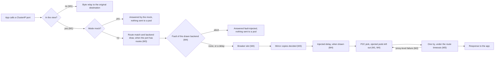

# Mimic mesh: what was delivered, milestone by milestone

> Status: **retro documentation, 2026-11-18** (#547). These pages describe what is merged on
> `main` for the milestones M0 to M4 of the mimic mesh, with the decisions taken on their issues
> and diagrams drawn from the code under `crates/mimic-core/src/mesh` and
> `crates/mimic-sidecar/src/mesh`. They change no behaviour. The forward design is
> [`../mimic-mesh.md`](../mimic-mesh.md); the contract is [`docs/SPEC.md`](../../SPEC.md)
> (§7.9 and the criteria of §12.20 to §12.29), and the spec wins wherever a page here differs.

## Pages

| Milestone | Page | Issues | Criteria | State |
|---|---|---|---|---|
| M0 | [Mode `none`](m0-mode-none.md) | #439, #490 | `NON-01` to `NON-11` (§12.20) | delivered |
| M1 | [`MimicConfig`, the view, its controller and its sidecar, load balancing](m1-view.md) | #440, #441, #442, #443, #444 | `MSH-01` to `MSH-88` (§12.21) | delivered |
| M2 | [Retries and the retry budget](m2-retries.md) | #445, #446, #518 | `RTY-01` to `RTY-58` (§12.22) | delivered |
| M3 | [Routes, timeouts, mirrors](m3-routes.md) | #447, #448, #449, #450 | `RTE-01` to `RTE-96` (§12.23 to §12.26) | delivered, except the mirror cost of `RTE-94` (#542) |
| M4 | [Outlier detection and circuit breaker](m4-outlier-breaker.md) | #451 | `CBR-01` to `CBR-36` (§12.27) | delivered |
| M4 | [Fault injection](m4-faults.md) | #452 | `FLT-01` to `FLT-32` (§12.28) | delivered with #452 |
| M5 | [The admission contract in the inbound sidecar](m5-admission.md) | #453 | `ADM-01` to `ADM-34` (§12.29) | delivered with #453 |
| M5 | [Signalling: metrics, dashboards, load tests counting refusals](m5-admission.md#signalling-454) | #454 | `ADM-50` to `ADM-66` (§12.29) | in progress |
| M6 | [The GatewayClass `mimic` and the Gateway reconciler](m6-gateway.md) | #456 | `GW-01` to `GW-30` (§12.30) | delivered with #456 |

The autoscaling (#455) of M5 is not started. Of the north-south gateway (M6), the GatewayClass and the Gateway
reconciler are #456; the HTTP data plane (#457) and HTTPS listeners (#458) are not started. Mesh traffic management
beyond these milestones is v2.

## One request through the mesh, and which milestone added each step

On the callee's side, the inbound sidecar of each pod applies its admission contract before its app sees a
request (M5, [m5-admission.md](m5-admission.md)): a refusal `overloaded` or `queue-timeout` names the pod, and the
caller's sidecar retries it on another pod at the "proxy-level failure" edge above.

## Conventions of the pages

- Every page has the goal, the key decisions (each with its reason and the issue where it was
  taken), three Mermaid diagrams (a decision flowchart, a workflow flowchart or state diagram, a
  sequence diagram), the criteria prefixes and their ranges, the known limits and the open
  follow-ups.
- An edge or a note labelled with a criterion ID (`MSH-51`, `RTY-03` …) is the behaviour that
  criterion of `docs/SPEC.md` §12 tests. The test of a criterion is named after it
  (`rty_03_…`), so `git grep -i rty_03` finds it.
- Levels of the criteria, as in §12.2: **U** unit (`mimic-core`), **I** integration
  (`crates/*/tests`), **E** kind end to end (`scripts/e2e.sh`) or chart check, **F** fuzz, **B**
  criterion micro-benchmark, **M** a run by hand recorded on the issue (`scripts/bench.sh`),
  **D** review.
- Decisions marked *autonomous* were taken with the recommended option while the maintainer
  was away, and recorded on the issue; they can be revisited there.

## The code, by layer

| Layer | Modules |
|---|---|
| `mimic-core` (pure: no tokio, no I/O, no clock; times and random draws are passed in) | `gateway::input`, `gateway::accept`, `gateway::objects`, `gateway::status` (M6), `mesh::input`, `mesh::policy`, `mesh::view`, `mesh::route`, `mesh::lb`, `mesh::retry`, `mesh::timeout`, `mesh::mirror`, `mesh::outlier`, `mesh::fault`, `mesh::admission`, `mesh::strip`, `mesh::head` |
| `mimic-controller` | `mesh::watch` (reflectors), `mesh::convert` (objects to input structs), `mesh::hub` (debounce, build, cache, long-poll), `mesh::status` (`MimicConfig` and `HTTPRoute` status), `mesh::config`, `mesh::metrics` |
| `mimic-sidecar` | `mesh::follow` (long-poll), `mesh::store` (state file), `mesh::router` (per-port tables, budgets, outlier state, breaker counts), `mesh::serve` (per-request path), `mesh::dial` (L4 and TLS), `mesh::pool`, `mesh::replay` (body bytes held for retries and mirrors), `mesh::gate` (the HTTP/1 head reader in front of `hyper`), `mesh::admit` (the pod's admission state and its queue timer), `mesh::metrics` |
