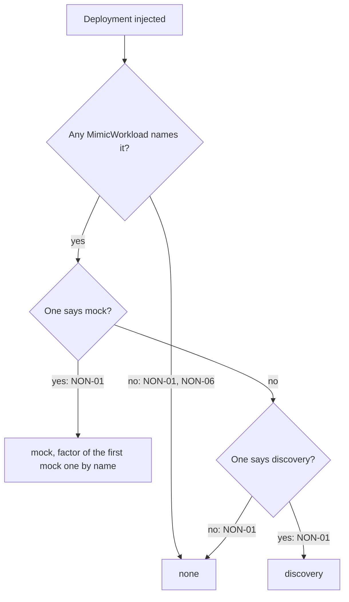
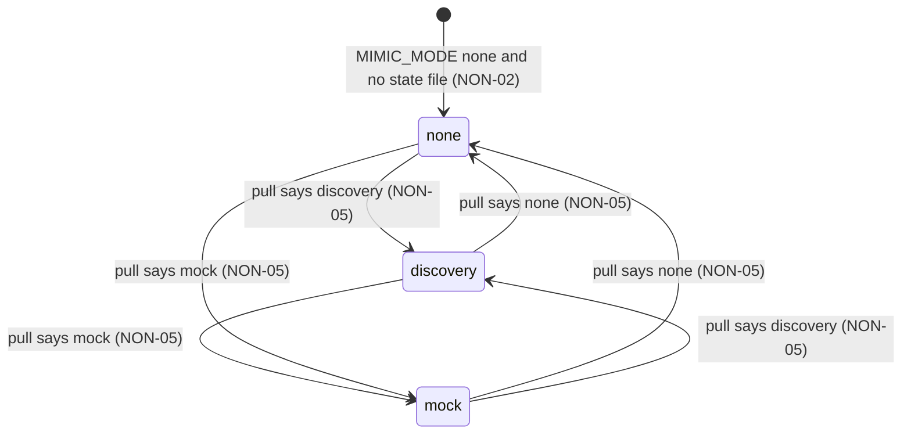
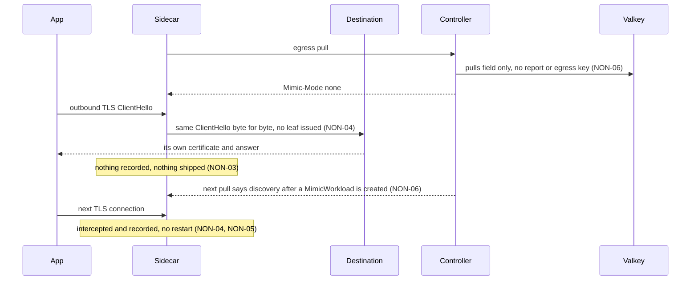

# M0: mode `none`, the new default

> Retro page (#547) of [the mesh milestones](README.md). Issue #439, latency follow-up #490.
> Spec: §3, §5, §7, §8, criteria §12.20. Design: [`../mimic-mesh.md`](../mimic-mesh.md) §2, §3.4, §14.

## Goal

A third mode, `none`: the sidecar is a plain proxy that records nothing, and it becomes the
default. A deployment injected by label without any `MimicWorkload` no longer records its
traffic; recording is something a team asks for (`spec.mode: discovery`). `none` means "proxy
only, nothing recorded", not "no mesh": the mesh of M1 works the same in `none` and
`discovery`.

## Key decisions

| Decision | Reason | Where |
|---|---|---|
| `none` is the default for label-injected deployments and the CRD default of `MimicWorkload.spec.mode` | Recording is opt-in: nothing of a workload's traffic is held or shipped unless asked | #439, design §2 |
| A `MimicWorkload` created before M0 keeps `spec.mode: discovery` | The API server persisted the old default at creation, so an upgrade does not silently stop recording; `CHANGELOG.md` has the upgrade note | #439, NON-07, NON-09 |
| Effective mode `mock` > `discovery` > `none` | Mock wins so that nobody's load test calls a real provider because another `MimicWorkload` still says `discovery` | spec §7, NON-01 |
| `none` passes outbound TLS through (`interception: mode_none`) | Interception costs CPU, a handshake and a trust dependency for no benefit when nothing is read; in-cluster mesh traffic is mostly cleartext | design §2, NON-04 |
| The sidecar keeps the trust install and the mode pull in `none` | A switch to `discovery` or `mock` needs no restart | spec §3, NON-05 |
| `none` is not a mesh kill switch | The mesh has its own switches (`mesh.enabled`, `MimicConfig.spec.mesh.enabled`) | design §3.4, NON-09 |
| The M0 latency budget is absolute: the `none` pair adds at most 1.5 ms p50 (HTTP/1.1) and 3.0 ms (h2c) at 200 rps over a 5 ms service, CPU at most 70 % of `discovery` | The former ratio (hop over hop plus recording) gets worse whenever recording gets cheaper; #490 showed the hop is the pod legs and wake-ups, not sidecar code. Measured 1.43 / 2.76 ms, CPU 56 % / 67 % | #439 comment of 2026-11-12, #490, design §14 |
| `record` stays refused | It was never a mode; `MIMIC_MODE=record` still exits 2 | NON-02 |

## Decision: the effective mode of a deployment

## Workflow: the mode of one sidecar

Each switch writes `mode changed` (`mode`, `previous`, `source: pull`), updates the
`mimic_mode{mode}` gauge and the state file, and never restarts the pod. A connection kept open
across a switch to `none` stops being recorded from its next exchange.

## Sequence: traffic in `none`, then a switch to `discovery`

## Criteria

| Prefix | Range | Levels |
|---|---|---|
| `NON` | `NON-01` to `NON-11` (§12.20) | U: 01, 02; I: 03 to 06; E: 07 (chart), 08 (kind section `non_08`); D: 09, 11; M: 10 (bench) |

## Known limits

- An outbound TLS connection opened in `none` stays passed through until it closes, even after
  a switch to `discovery` (spec §3).
- A mode change reaches the pods within one `MIMIC_EGRESS_PULL_INTERVAL`; from M1 the view also
  carries the mode, so it arrives within about a second while the sidecar follows a view.
- Deployments injected by label that relied on the old `discovery` default stop recording after
  the upgrade: the upgrade note in `CHANGELOG.md` says how to get it back (a `MimicWorkload`
  with `spec.mode: discovery`).

## Open follow-ups

None: #439 and #490 are closed, the budget is met.
