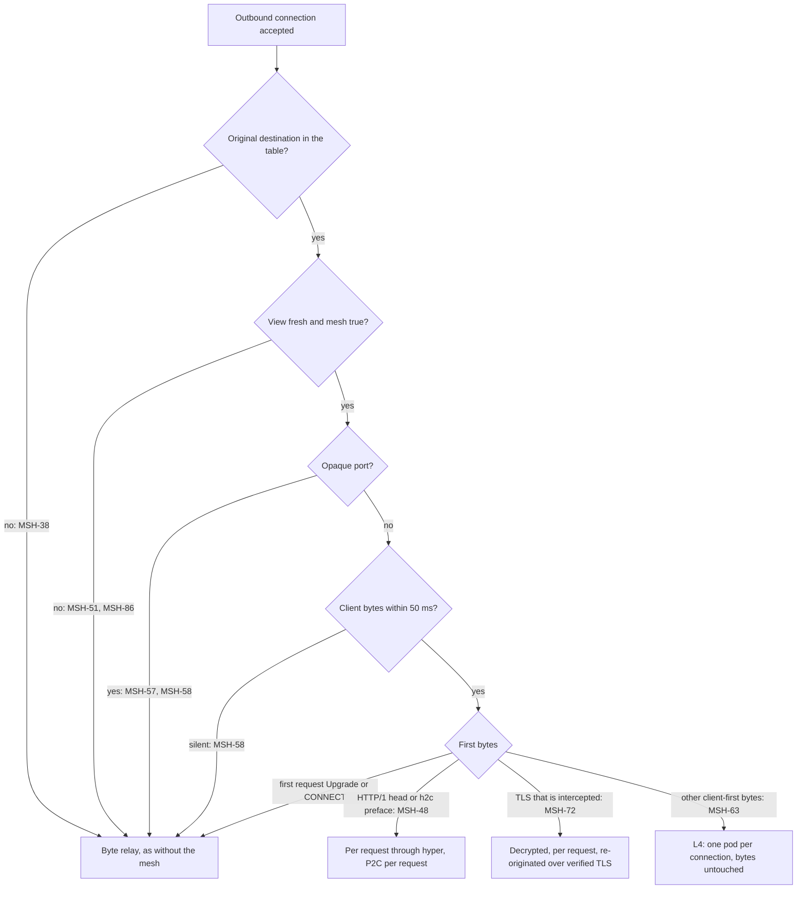
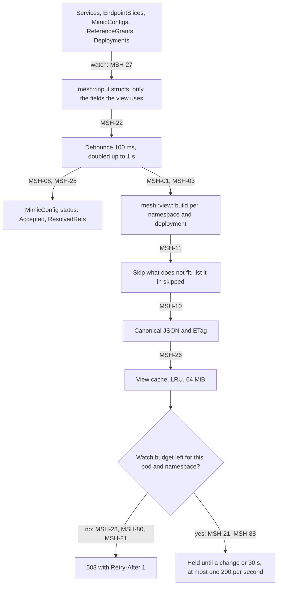
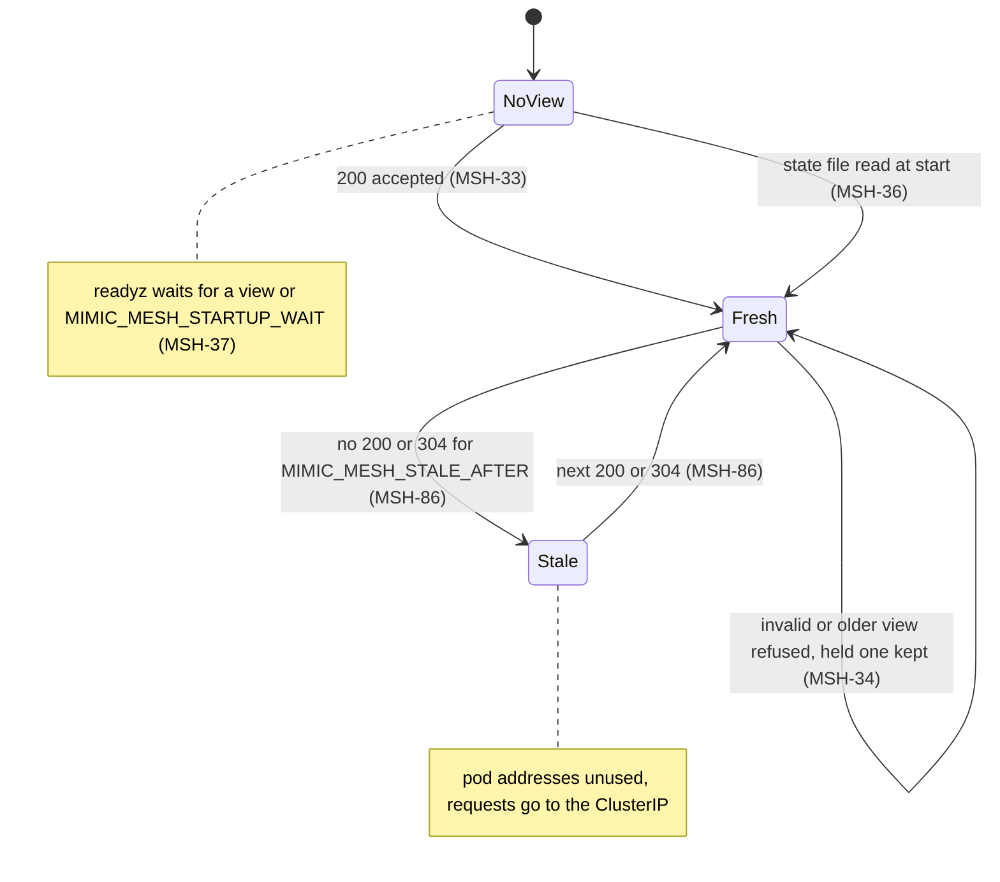
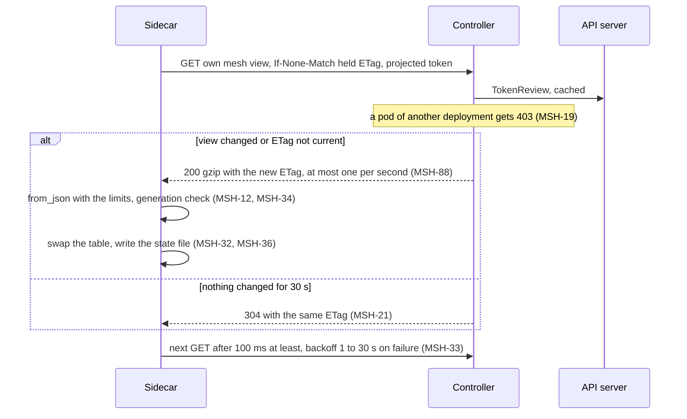

# M1: `MimicConfig`, the mesh view, its controller and its sidecar

> Retro page (#547) of [the mesh milestones](README.md). Issues #440 (CRD and pure view), #441
> (controller), #442 (sidecar follows the view), #443 (load balancing), #444 (failure modes).
> Spec: §7 (`MimicConfig`), §7.2 (the route), §7.9, §10.2, criteria §12.21. Design:
> [`../mimic-mesh.md`](../mimic-mesh.md) §3.1, §3.2, §3.4, §4, §6, §14.

## Goal

The caller's sidecar picks the pod that serves a call, instead of kube-proxy. The controller
builds, for each deployment, a **view**: the Services it may call, their ports, their ready pod
IPs and their policy. Each sidecar long-polls its view, maps `<ClusterIP>:<port>` to a Service,
and balances each in-scope request (or connection, for non-HTTP traffic) over the pods with
power of two choices, least request, slow start and per-pod pools. Everything out of scope, and
everything with the mesh switched off, keeps the byte relay.

## Key decisions

| Decision | Reason | Where |
|---|---|---|
| The view is a pure function of plain input structs (`mimic-core` `mesh::view::build`), as canonical JSON with the ETag `"1-"` plus its SHA-256 | Two replicas serve the same bytes and ETag whatever the order of their lists; the scope rules are unit tested, property tested and fuzzed without a cluster | #440, design §4.2, MSH-09, MSH-10, MSH-13 |
| Scope: every Service of the own namespace, plus the declared `destinations`; another namespace only with its `ReferenceGrant`; no `ReferenceGrant` CRD means nobody consents; the same answer whether the Service exists or not | A namespace's data never reaches a view without its consent, and the answer does not reveal whether a Service exists | #440, review B2 of #469, MSH-03, MSH-04 |
| A Service that does not fit the bounds is skipped and the next ones are still tried | With "stop at the first one", one large Service of the own namespace hid every Service after it, declared destinations included | review of #495, recorded on #441, MSH-11 |
| Long-poll with `If-None-Match` on the existing sidecar API, full views, gzip | Keeps the authenticated, sidecar-initiated channel with push-like latency. An xDS stream (protobuf toolchain, half a protocol), a controller push (a listener and authentication on every sidecar) and a periodic pull (stale endpoints during rollouts) lost; deltas lost to self-healing full state | design §4.3 |
| Watch isolation: at most 2 held long-polls per pod and 25 % of the watch budget per namespace; pushes and TLS issuance outside the budget | Security review F2: one pod could spend the global budget for everyone | #441 (autonomous), MSH-80, MSH-81 |
| Pacing: at most one `200` view per second per pod (`MIN_VIEW_INTERVAL`), coalesced to the latest | The rollout bench measured 1.54 views/s per sidecar against the 1/s budget: the debounce alone let bursts through | #441 (autonomous), MSH-88 |
| Generation check, keys carrying the object's UID | Two replicas may lag each other; a recreated object is a new key, never "older" | design §4.3, MSH-34 |
| The view is persisted (`state/mesh.json`), its mode is not applied at start | A restart with the controller away still balances; the mode comes from the mode state file, then `MIMIC_MODE` | #442, MSH-36 |
| P2C least request with slow start, in `mesh::lb` | Linkerd's and Envoy's default, local state only, good under uneven latency; round robin and random lack load feedback, peak EWMA needs tuning | design §3.2, MSH-43 to MSH-46 |
| In-scope HTTP/1 is re-framed through `hyper` (`preserve_header_case`, no header added) | Per-request balancing, retries and pools are impossible on the byte relay; a pooled client of our own on the codec was more code and risk | design §3.1, MSH-53, MSH-67 |
| A failed connect avoids the pod for 5 s; the request goes to another pod, then to the ClusterIP | A blackholed pod cost a 10 s connect timeout per request; now it costs one `MIMIC_MESH_CONNECT_TIMEOUT` (2 s) | review of #506 on #443, MSH-68 |
| Intercepted TLS is re-originated and verified against the name the app sent (else `<name>.<namespace>.svc`), never the pod IP, with no switch to turn it off | A pod is never spoken to in cleartext and verification cannot be bypassed | #443 step 3 (#511), MSH-72, MSH-73 |
| Pools per (pod IP, port, protocol, server name), at most 8 TLS pools per pod | Security review F2 of #443: the server names are the app's to choose | #513, MSH-77 |
| A stale view is not used for pod addresses: requests go to the ClusterIP, never trusted | A dead controller never turns pod churn into errors; on the ClusterIP the caller no longer knows which pod it reached | #444, MSH-86 |

## Decision: what happens to an outbound connection

With `MIMIC_MESH=off` nothing is classified at all. The mode applies per request on a
mesh-routed connection: in `mock` the mock answers and nothing reaches a pod (MSH-62).

## Workflow: how the controller builds and serves a view

Both replicas watch and build; from M3 the `HTTPRoute`s join the watched objects
([M3](m3-routes.md)). The policy of each Service in the view comes from its winning
`MimicConfig` (oldest first, then by name) or the defaults.

## Workflow: the view a sidecar holds

## Sequence: one long-poll

## Criteria

| Prefix | Range | Issue | What |
|---|---|---|---|
| `MSH` | `MSH-01` to `MSH-17` | #440 | `MimicConfig` CRD, `mesh::policy`, `mesh::view`, `from_json`, fuzz, bench, chart, CEL e2e |
| `MSH` | `MSH-18` to `MSH-30`, `MSH-80` to `MSH-84`, `MSH-88` | #441 | controller config, route, long-poll, debounce, watch budget and isolation, cache, adapters, RBAC, pacing |
| `MSH` | `MSH-31` to `MSH-42` | #442 | sidecar config, table, follow, generations, mode, persistence, readiness, classification |
| `MSH` | `MSH-43` to `MSH-79` | #443 | P2C, slow start, pools, HTTP/1 through `hyper`, opaque ports, L4, head reader, intercepted TLS, review follow-ups |
| `MSH` | `MSH-85` to `MSH-87` | #444 | `no-endpoint`, stale view and recovery, controller down (kind `msh_87`) |

Budgets of design §14 (M1 row) met: p50 within +0.25 ms of the pre-mesh mean, P2C pick 21 to
41 ns, controller RSS 26.3 MiB with 1000 Services and 10 000 endpoints, propagation p99 about
0.8 s (bench in `docs/bench/`, #517).

## Known limits

- Mesh-routed HTTP/1 is not byte-exact (spec §4.1 limits): header order across names, chunk
  extensions, hop-by-hop fields consumed per hop, pipelined requests serialised.
- A client silent for 50 ms, or whose first head is not whole within 16 KiB, and a first
  request with `Upgrade` or `CONNECT`, keep the byte relay for the whole connection. An HTTP/2
  `CONNECT` is answered `501`.
- Balancing is per caller sidecar: each counts only its own requests in flight.
- Services and deletions carry no generation: a regression from a lagging replica lasts at most
  its watch delay (design §4.3).
- RBAC cannot limit the `Deployment` read to metadata: the code asks for `PartialObjectMeta`, the
  grant is cluster-wide (security review F1 of #441, documented).
- The pod identity of the view route is a name pattern within the token's namespace (F5 of
  #441, accepted: it cannot cross namespaces).
- Over intercepted TLS a pod that requests a client certificate fails the handshake (`503`).

## Open follow-ups

- #515 (M1 follow-ups): the pool sweep against an HTTP/2 connect in flight, a metrics series
  created untracked, an info line when the view's ETag changes, a same-name pod restart counted
  against its per-pod watch cap, a pull with a stale ETag after a `304` that skips the 1 s
  pacing, and the review notes collected there since.
