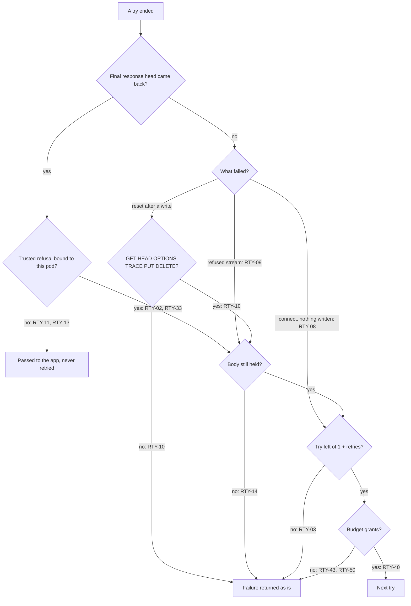
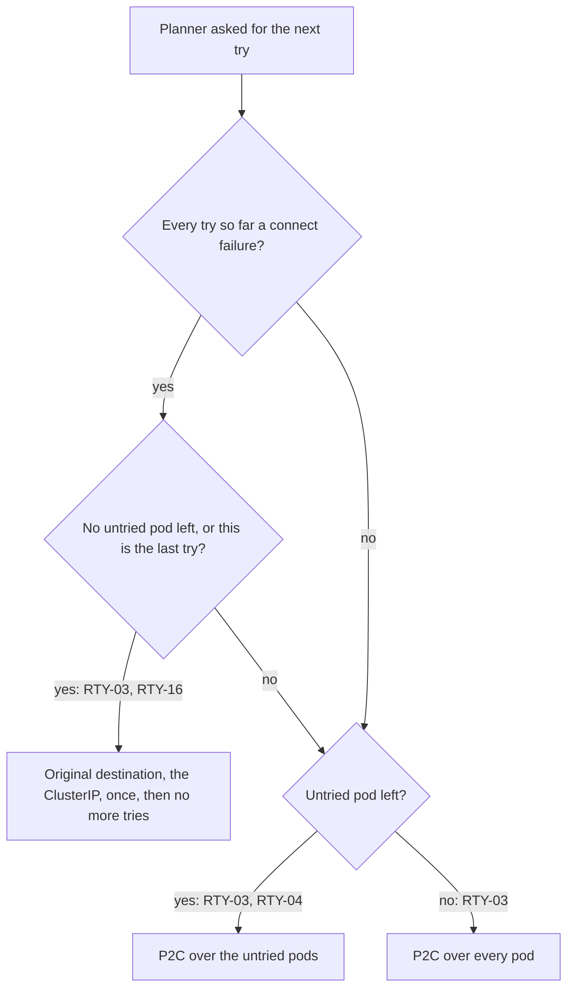
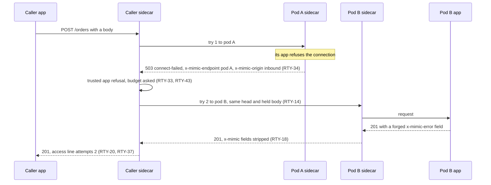

# M2: retries of proxy-level failures, and the retry budget

> Retro page (#547) of [the mesh milestones](README.md). Issues #445 (retries), #446 (retry
> budget and `MimicConfig.retries`), #518 (a meshed callee answers when its app refuses the
> connection). Spec: §4.1 ("Mimic fields of app responses", "Refused app connections"), §7,
> §7.9 "Retries", §10.3, §11.1, criteria §12.22. Design: [`../mimic-mesh.md`](../mimic-mesh.md) §7.

## Goal

A mesh-routed request is tried again on another pod **only when its failure happened before
the app could process it**: a connect failure, a refused HTTP/2 stream, a refusal that the
callee's own sidecar produced, or a reset of an idempotent request before any response byte. A
response of an app, any status (`5xx` included), is never retried. The number of tries is
bounded per request (`retries`) and, from #446, per caller pod and Service over time (the
retry budget).

**`retries: 3` means up to 4 tries**: the first try plus 3 retries, the fallback to the
ClusterIP included. `retries: 0` gives one try, no fallback and no draw on the budget.

## Key decisions

| Decision | Reason | Where |
|---|---|---|
| Only proxy-level failures are retried, never an app status | Semantics of Linkerd and Istio (owner decision): an app answer may have side effects | design §7, RTY-01, RTY-11 |
| A `503` `x-mimic-error` is trusted only with exactly one `x-mimic-endpoint` equal to the pod of this try, on cleartext; a meshed inbound sidecar strips every `x-mimic-*` field of its app's responses | A forwarding app must never make its own callers retry (review B1 of #469); the binding also covers peers that do not strip | design §7, #445, RTY-02, RTY-13, RTY-18, RTY-19 |
| The ClusterIP fallback is one of the `1 + retries` tries: only after connect failures alone, at most once, and it ends the tries | Keeps "at most 4 tries" by default; a 5th try lost | #445 (accepted architect choice), RTY-03 |
| A reconnect of an unwritten request is part of its try; tries to the ClusterIP are never trusted nor retried | No pod can be bound on the ClusterIP; MSH-86 kept | #445, RTY-15 |
| A `GOAWAY` counts as a refused stream only when its last-stream-id is 0 | `hyper` does not expose the stream id; the narrower rule never resends a request the pod may have processed | #445 (autonomous, 2026-11-14), RTY-09 |
| While the inbound side strips, a response head its codec cannot frame ends the connection | Otherwise an app could send one unframeable head, then forge a refusal | review of #521 on #445 (autonomous) |
| Body replay: at most `MIMIC_MESH_RETRY_BUFFER` (64 KiB) per request and `MIMIC_MESH_RETRY_BUFFER_TOTAL` (8 MiB) per sidecar, charged at the buffer's capacity | A per-request cap alone is unbounded over many HTTP/2 streams; 1-byte chunks cost about 32 times their size before coalescing (F2) | #445, RTY-14, RTY-27 |
| A request body that failed is latched and never replayed | A retry could otherwise end a cut chunked upload "cleanly" (security review F1, high) | #445, RTY-26 |
| A pure planner and classifier in `mimic-core` `mesh::retry` | `tower::retry` knows nothing of pods and needs `Clone` requests; `hyper-util`'s retry covers only unwritten requests and cannot choose a pod; a pure planner is tested exhaustively | #445 |
| No delay after connect failures, refused streams, trusted app refusals and resets; 25 ms ± 50 % after an `overloaded` or `queue-timeout` refusal | Those kinds say nothing about load; an admission refusal does | design §7, RTY-03 |
| A meshed inbound sidecar answers `503` `connect-failed` with `x-mimic-endpoint` and `x-mimic-origin` when its app refuses the connection (cleartext HTTP/1, `h2c`) | Before, such a callee looked like a reset and a `POST` was not retried | #518, RTY-33 to RTY-39 |
| Budget per caller pod and backend **Service** (all its ports), 10 slots of `window / 10`, integer formula `100 × (retries + 1) ≤ percent × requests + 100 × minPerSecond × window` | The policy unit is the Service; a token bucket is the same semantics but a harder testable formula; an exact timestamp log is unbounded; a per-port budget is more state | #446, RTY-40 to RTY-42 |
| The fallback draws on the budget; each L4 connection is one request of the budget | The fallback is a retry; L4 connects are retried too | #446 decisions 2 and 5, RTY-53 |
| A refused retry does not wait for the budget to refill; it is counted only in `mimic_mesh_retry_budget_exhausted_total` | Linkerd's behaviour; counting it in `retries_skipped_total` too would double count | #446 decisions 4 and 7, RTY-50 |
| The budget survives view updates; a new `window` resets it; a Service that leaves the view loses it | Bounded state (one budget per Service of the view) without a reset on every endpoint change | #446 decision 6, RTY-54 |
| Defaults `retries: 3`, `retryBudget: {percent: 20, minPerSecond: 10, window: 10s}`, set by `MimicConfig` on a Service only, no `MIMIC_*` variable | The issue's defaults; the policy comes from the view | #446, RTY-44 |

## Decision: is a failed try retried?

"As is" means: `503` `connect-failed` after connect failures, the refusal as received, a reset
propagated, a refused stream reset `REFUSED_STREAM`. From M3 a route timeout is never retried
(RTE-61), and from M4 a `breaker-open` answer neither (CBR-28).

## Workflow: where the next try goes

With 5 pods all refusing connections and `retries: 3`, the tries are three distinct pods, then
the ClusterIP: 4 tries, the fifth pod never tried (RTY-03). With one pod: that pod, then the
ClusterIP. From M4 an ejected pod is never chosen ([M4](m4-outlier-breaker.md)).

## Sequence: a callee whose app refuses the connection

## Criteria

| Prefix | Range | Issue | What |
|---|---|---|---|
| `RTY` | `RTY-01` to `RTY-25` | #445 | classification, trust, planner (U, proptest), config, stripper and its fuzz target, sidecar tests 08 to 20, kind `rty_21` and `rty_22`, bench `mesh-refuse`, docs and security reviews |
| `RTY` | `RTY-26` to `RTY-30` | #445 | the security review findings F1, F2, F3, F7, F8 |
| `RTY` | `RTY-33` to `RTY-39` | #518 | trusted app refusal: `trusted`, the inbound answer, what stays, metric, callers retry, docs, kind `rty_39` |
| `RTY` | `RTY-40` to `RTY-58` | #446 | budget arithmetic and window (U, proptest), policy and view, CRD and CEL, sidecar wiring, WARN, labels, kind `rty_56`, docs, security review |

`RTY-31` and `RTY-32` are unused. Budget of design §14 (M2 row): no change against M1 without
failures (at most 0.2 ms p50); with one of three pods refusing connections, 0 % client errors
and p99 within M1 plus 5 ms (RTY-23).

## Known limits

- **A pod can make its callers retry requests sent to itself**: an app whose sidecar does not
  strip (no sidecar, mesh off, inbound TLS) can forge a refusal bound to its own address; the
  requests go to its siblings, at most `retries` more times (spec §11.1).
- **Idempotent by method name**: a `GET`, `HEAD`, `OPTIONS`, `TRACE`, `PUT` or `DELETE` that a
  pod read and dropped is sent to another pod; resets that every tier propagates can grow by
  `(1 + percent/100)` per tier plus the floors, bounded by the budget (spec §11.1).
- **The budget is per caller pod**: N caller pods each keep their own floor; whoever may write a
  `MimicConfig` for the Service can raise it for every caller (spec §11.1).
- **An injected callee whose app refuses connections over TLS looks like a reset**: its sidecar
  does not decrypt, so it cannot answer (spec §11.1).
- **Inbound heads are held when the mesh is on**, and a response the codec cannot frame closes
  the inbound connection (spec §11.1).
- No timeout without a route (M3 adds route timeouts only).

## Open follow-ups

- #515 collects the non-blocking review notes of the M2 PRs (#521 to #526): an incomplete
  response head at the app's EOF relayed unstripped before the FIN, a three-tier
  `connect-failed` test, a rate limit on the `inbound connect failed` warning, the capacity
  charge of sealed replay segments.
