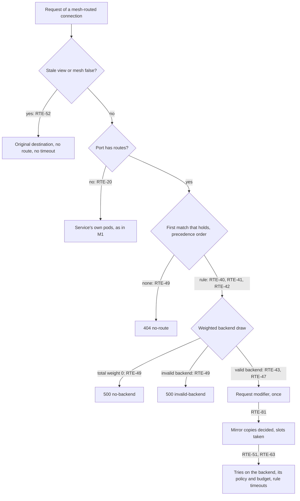
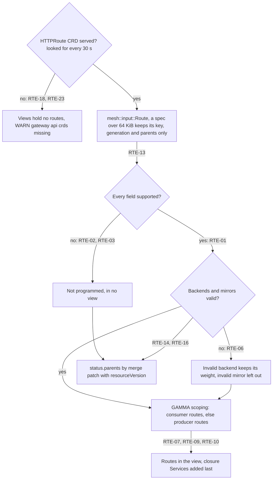
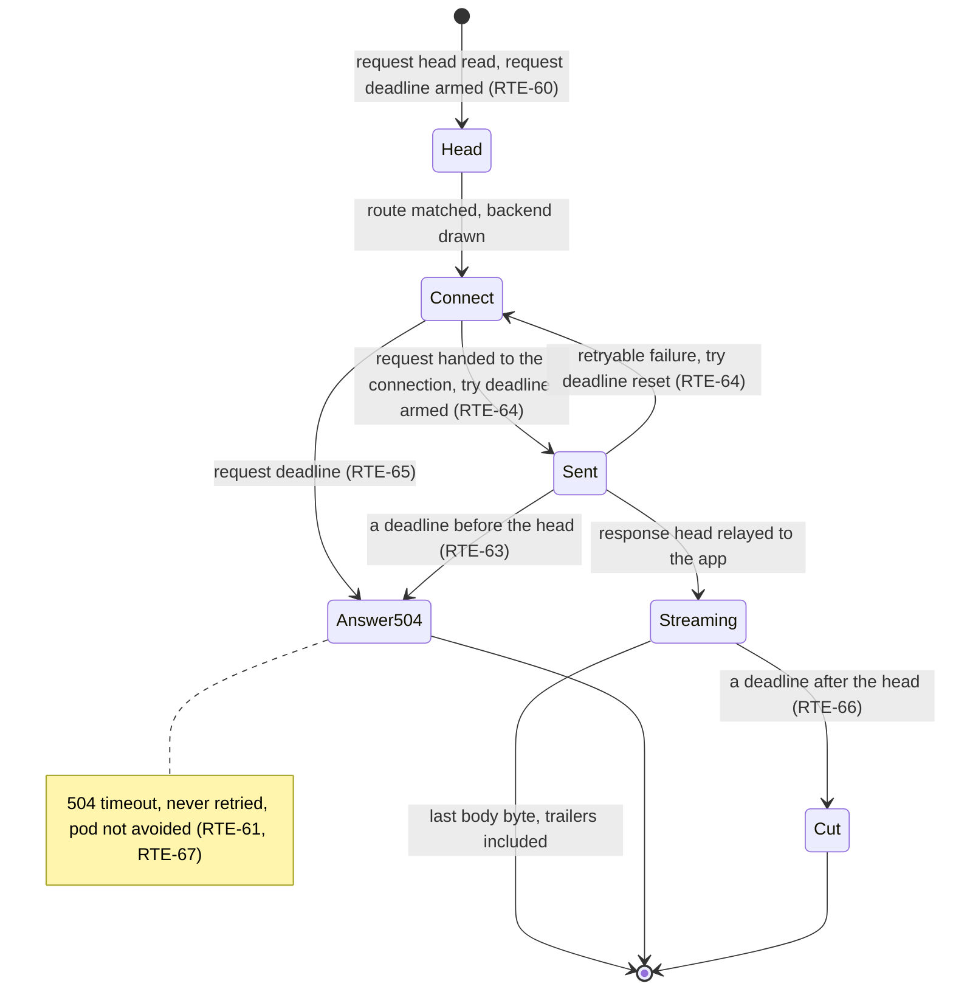
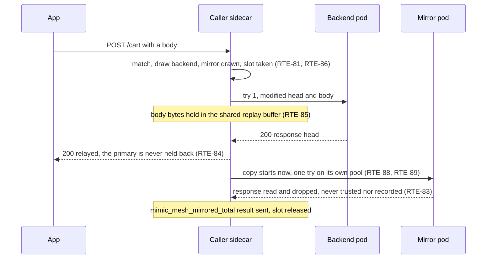

# M3: HTTPRoute routing, timeouts and mirrors

> Retro page (#547) of [the mesh milestones](README.md). Issues #447 (Gateway API prerequisite
> and HTTPRoute ingestion), #448 (matching, header modifiers, weighted backends), #449
> (timeouts), #450 (RequestMirror). Spec: §2, §4.1, §7, §7.2, §7.9 ("Routes", "Routing",
> "Timeouts", "Mirrors"), §9, §11.1, criteria §12.23 to §12.26. Design:
> [`../mimic-mesh.md`](../mimic-mesh.md) §3.1, §5, §12, §14.

## Goal

Service-level traffic management from the Gateway API `HTTPRoute` of the GAMMA convention
(`parentRefs` a Service): the controller reads, validates and reports the routes and puts them
in the views of the callers they apply to; the caller's sidecar matches each request against
them, draws a weighted backend (canary), applies header modifiers, bounds the call and each try
with the rule's timeouts, and sends best-effort copies to mirrors. A port without routes is
balanced as in M1.

## Key decisions

| Decision | Reason | Where |
|---|---|---|
| Route status by JSON merge patch on `/status` with the `resourceVersion` read, not server-side apply | `status.parents` is an atomic list shared with other controllers: an apply would take the whole list over | #447 decision 1, RTE-14, RTE-16, RTE-24 |
| A route with an unsupported, unknown or experimental field, or a modifier naming `host`, framing, hop-by-hop or `x-mimic-*` fields, is not programmed (`UnsupportedValue`, the first field path, no value copied) | A half-applied route is worse than none; a route never changes framing, the authority or the mesh's own signals | #447 decisions 2 and 3, RTE-02, RTE-03 |
| Gateway API applied strictly: a backend or mirror in another namespace needs that namespace's `ReferenceGrant` `from: HTTPRoute`; a `MimicConfig` grant does not count | No path puts a namespace's data in a view without its consent | #447 decision 4, RTE-06 |
| GAMMA scoping: the consumer routes of the caller's namespace if any, else the producer routes of the Service's namespace; a third namespace never applies | A consumer route changes only its own namespace's calls | spec §7.9 "Scoping", RTE-07 |
| Route closure of depth 1, its Services last under the view bounds | Backends and mirrors must be in the view; their own routes are not followed (no chains) | #447, RTE-09, RTE-10 |
| Gateway API pinned to v1.7.0 `standard-install.yaml` by SHA-256 | `retry` is Standard there and `ReferenceGrant` v1beta1 still served | #447, RTE-25 |
| A request that matches no rule of a port with routes is answered `404` `no-route` | The GAMMA docs, Istio and Linkerd do so, and users move routes from those meshes; a catch-all rule to the Service itself gives the old behaviour back | #448 (autonomous, against the issue text) |
| One list of matches per port, sorted by the Gateway API precedence key, built once per view | `select` over 100 rules stays far under 10 µs; a trie lost (more code, views change rarely) | #448, RTE-40, RTE-46 |
| The backend is drawn once per request; every try, retry and the fallback stay on it, with its own policy and budget; the fallback is the backend's ClusterIP | A re-draw skews the weights under failure and mixes two budgets; the parent's ClusterIP can land on pods of the wrong version | #448, RTE-51 |
| The request modifier is applied once, before the first try | Per try, a replay would add the lines again | #448, RTE-50 |
| Paths compared byte for byte, no normalisation; repeated header lines joined with `,`; the first query pair of a name wins | Normalising diverges from what the callee sees, and routes are routing, not authorisation | #448, RTE-41, RTE-42 |
| `500` `no-backend` and `invalid-backend` (an invalid backend keeps its share) | The Gateway API requires a `500` for an invalid backend's share | #448, RTE-49 |
| No default timeout without a route; `request` from the request head, `backendRequest` from the hand-off of the try's request, both to the last response byte | The issue's scope and the Gateway API wording ("as close to the whole transaction as possible") | #449 decisions 1 to 3, RTE-60, RTE-63 to RTE-65 |
| An expiry is never retried and asks nothing of the budget; an expiry in a refusal pause answers `504` | A `504` does not mean "not processed"; the route's promise wins over the retry | #449 decision 4, RTE-61, RTE-64 |
| After the head: HTTP/1 connection closed, HTTP/2 stream reset `INTERNAL_ERROR`; the try's HTTP/1 connection to the pod is never reused | A late response can never answer another request (no desync) | #449 decision 5, RTE-66, RTE-67 |
| A timed-out pod is not avoided | A slow pod is not a failed connect; outlier detection is M4 | #449 decision 6 |
| One `select!` per try plus a body deadline, at most two timers per request | `tower::timeout` covers only the response future; a whole-call timeout cannot say which one fired and would give the HTTP/1 lease back to the pool | #449, RTE-69 |
| Mirror copies: the whole body or skipped, sharing the replay accounting; head after the modifier unless `beforeModifier`; the app's `Host`; no marker | Teeing a streaming body needs a buffer or backpressure; a `-shadow` host suffix breaks vhosts and TLS verification | #450 decisions 2 and 4, RTE-82, RTE-83, RTE-85 |
| Copies: one try, own pools, the shared endpoint state, 256 per mirror Service port and 1024 per sidecar, a 10 s deadline or the rule's timeouts | A slow mirror never takes a primary connection; a silent mirror cannot pin slots; the pod's load is real | #450 decisions 1 and 3, RTE-86, RTE-88, RTE-89 |
| A copy starts only once the primary's response head arrived (or the primary ended without one) | The RTE-94 bench measured +0.96 ms (HTTP/1) and +1.37 ms (`h2c`) p50 when copies started with the primary; +0.26 / +0.59 ms after the change | #450 (autonomous, 2026-11-15), RTE-84 |

## Decision: one request on a port

In mode `mock` the mock answers before any route. From M4 the breaker slot of the drawn
backend is taken right after the draw: a `breaker-open` answer has no copy and no try
([M4](m4-outlier-breaker.md)). `Upgrade`, `CONNECT` and L4 traffic are not routed.

## Workflow: how the controller ingests a route

The status has one entry per existing Service parent, with
`controllerName: mimic.platform.io/mesh` and the conditions `Accepted` and `ResolvedRefs`; a `409` is counted
`conflict` and decided again from the next object read (RTE-16, RTE-17).

## Workflow: a routed request under the rule's timeouts

## Sequence: a mirrored request

## Criteria

| Prefix | Range | Issue | What |
|---|---|---|---|
| `RTE` | `RTE-01` to `RTE-28` (`RTE-29` to `RTE-39` free) | #447 | compile, not programmed, consent, scoping, closure, bounds, `from_json`, converter, status writer, CRD presence, kind `rte_21`, pins, chart, docs, security review |
| `RTE` | `RTE-40` to `RTE-58` (`RTE-59` reserved) | #448 | precedence, paths, headers, query, method, weighted draw, modifiers, bench `mesh_route`, canary, sidecar answers, retries per backend, label bounds, kind `rte_55` |
| `RTE` | `RTE-60` to `RTE-73` (`RTE-74` to `RTE-79` reserved) | #449 | deadlines, never retried, expiry before and after the head, no reuse, timer bounds, views, kind `rte_71` |
| `RTE` | `RTE-80` to `RTE-96` (`RTE-97` to `RTE-99` reserved) | #450 | draw, decisions, `beforeModifier`, copy on the wire, never slows the primary, bodies, slots, share, pools, lifetime, TLS, labels, kind `rte_93`, bench `mesh-mirror`, docs, security review |

Budgets of design §14 (M3 row): route match at most 10 µs for 100 rules (RTE-46, met); canary
90/10 within ±2 % over 10 000 requests (RTE-47, met); a mirror adds at most 0.2 ms p50 to the
primary (RTE-94, **not met**: +0.26 ms HTTP/1, +0.59 ms `h2c`).

## Known limits

All in spec §11.1 (M3):

- Routes are as readable as the views they reach; a route's status says whether its parent
  Service exists; the status patch is not narrowed by RBAC; older or experimental Gateway API
  CRDs are not detected; one GAMMA implementation per Service; one watch per replica.
- Routes are routing, not authorisation: no path normalisation, and the app can reach any pod
  IP directly anyway.
- `Upgrade`, `CONNECT` and L4 traffic are not routed and have no timeout.
- Backends see the parent's authority; over intercepted TLS a backend is verified against the
  name the app sent, so another Service's pods fail verification (`503`, fails closed).
- A route timeout counts the app's own pace; a cut close-delimited HTTP/1.0 response can look
  complete; a producer route's timeouts bind every caller without a consumer route; a timed-out
  request may have been processed.
- A stale view routes nothing.
- Mirrors carry the caller's credentials unredacted to the mirror's pods; mirror loops across
  apps are not detected; mirroring is best effort; a mirror pod sees the copy late (by the
  primary's latency) and alone; copies count in the shared `in_flight`.

## Open follow-ups

- **#542, RTE-94**: the mirror's p50 cost is over the 0.2 ms budget (+0.26 ms HTTP/1, +0.59 ms
  `h2c` at 200 rps). To investigate: why `h2c` costs twice HTTP/1, the copy's work after the
  primary's head, and whether the rest is the single-host benchmark. #450 stays open until the
  budget is met or revised with a reason. The non-blocking notes on the copy gate of #533 are
  handled there too.
- #515 holds the other non-blocking review notes of #528, #529, #530 and #533.
