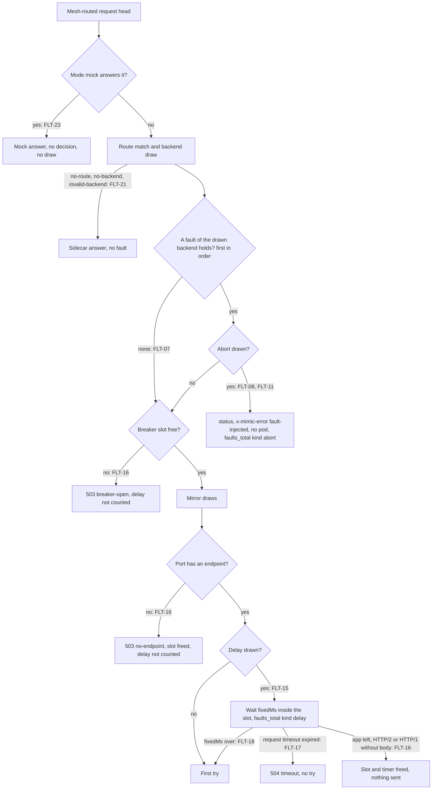
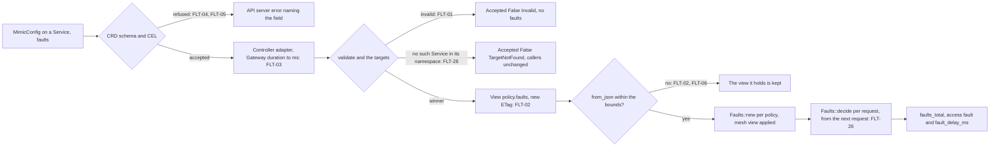
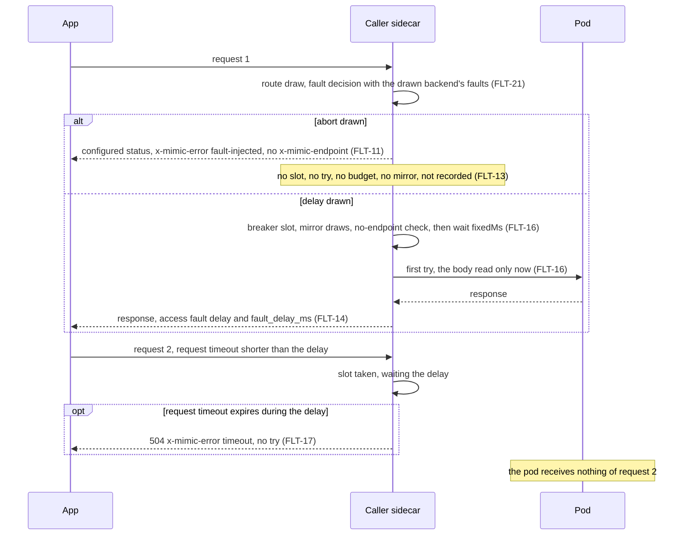

# M4: fault injection

> Page of [the mesh milestones](README.md), written with #452 (step 8). Issue #452. Spec: §4.1 (the
> mesh's answers, access `fault`, `fault_delay_ms` and `reason`), §7 (`MimicConfig` `faults`), §7.9
> (view `policy.faults`, "Routing" "Timeouts" and "Mirrors", "Circuit breaker" "What holds a slot",
> "Fault injection", "Configuration", "Metrics"), §9 (metric, `x-mimic-error` reasons), §11.1,
> criteria §12.28. Design: [`../mimic-mesh.md`](../mimic-mesh.md) §6, §9, §10, §12, §15. The other
> half of M4 is [outlier detection and the circuit breaker](m4-outlier-breaker.md).

## Goal

Resilience tests without touching the callee: the `faults` of a Service's `MimicConfig` make the
sidecar of **every injected caller** answer some of its mesh-routed requests to that Service itself
(an **abort**: the configured status and `x-mimic-error: fault-injected`) or hold them for a fixed
time before their first try (a **delay**), as Istio's and Envoy's HTTP fault filter does on the
caller's side. The inbound side injects nothing.

## Key decisions

| Decision | Reason | Where |
|---|---|---|
| The faults of the **drawn backend** Service apply, as for retries and the breaker, never those of the parent Service when a route drew another backend | A producer's faults never touch traffic that a consumer route sends elsewhere; a Service's faults reach only requests sent to its own pods | #452 decision 2, FLT-21 |
| Order: mock, route match and backend draw, **fault decision**, abort answered; else breaker slot, mirror draws, `no-endpoint` check, **delay**, first try. Decided once per request | The sidecar's own route answers come first; the order after the abort follows #451's code (the slot, then the mirrors, then `no-endpoint`); retries and the fallback are never delayed again | #452 decision 1, step 5 Q3, FLT-13, FLT-16, FLT-18 |
| `match` is one Gateway API `HTTPRouteMatch` (path, method, headers **and** query parameters), the #448 matcher reused; absent matches everything; the first fault that holds wins, in the config's order | The matcher exists at no extra cost; the author orders the faults, no Gateway API precedence | #452 decision 3, FLT-07, FLT-22 |
| Two independent 64-bit draws passed in, drawn when `⌊r × 100 / 2⁶⁴⌋ < percent`; an abort drawn wins (no delayed abort); integer percent only | No cross-field `a + d ≤ 100` CEL rule (Istio has none); the delayed share is `d × (1 − a / 100)`; the pure function stays testable without randomness | #452 decision 4, FLT-08, FLT-09 |
| An abort: the configured status 200 to 599, one `x-mimic-error: fault-injected`, `content-length: 0` (none for `204`, `304`), no `x-mimic-endpoint`; no try, no breaker slot, no budget, no mirror, no outlier outcome, no response modifier, never retried, never recorded | It names no pod, so no sidecar trusts it; faults must not eject pods nor consume what real requests need | #452 decision 5, FLT-11, FLT-13, FLT-20, FLT-24 |
| A delay (1 ms to 60 s) is waited **inside** the breaker slot | It costs what a slow pod costs and `maxRequests` bounds how many are held; before the slot (the #451 text) let a caller hold an unbounded number of delayed requests | #452 decision 6, FLT-16 |
| The delay counts against `request`, never `backendRequest`; a `request` expiring during the delay answers `504` `timeout` and starts no try | `request` starts at the head and bounds the whole call; `backendRequest` starts with a try | #452 decision 6, FLT-17 |
| The delay holds the head, the slot and one timer, no body byte; at most two timers per request | No retry buffer while waiting; the delay timer is dropped before a try timer is armed | #452 decision 6, FLT-16 |
| An HTTP/1 request with a body is seen leaving only when the delay ends | `hyper` watches an HTTP/1 connection for its close only once the body is read; reading it during the wait would hold the body and break FLT-16 | step 5 Q2, §11.1, FLT-16 |
| Discovery records a delayed exchange with the delay taken out of `head_ms`; aborts are not recorded | A mock built from the recording never replays a test fault | #452 decision 6, FLT-25 |
| Never faulted: mocked calls, out-of-scope destinations, stale views and `"mesh": false`, `Upgrade` and `CONNECT`, L4, mirror copies, inbound traffic; a passthrough connection accepted in mode `mock` takes the byte relay and is not | L4 has no request to answer (a delayed connect would be v2 with the other L4 work); mesh routing is decided when a connection is accepted, and changing that for passthrough touches every mesh feature | #452 decision 7, step 6 Q1 (option A, bcd8955), FLT-19, FLT-23, #549 |
| `mimic_mesh_faults_total{service,kind}`, `service` the policy's Service (bounded by the view, evicted 5 minutes after it leaves), `kind` `delay` or `abort`; access `fault` and `fault_delay_ms`; no component log per fault | Bounded labels, no request data; the policy is already visible in the view and `mesh view applied` | #452 design, FLT-12, FLT-14, FLT-26 |
| No `MIMIC_*` variable: faults come from the view's policy only; bounds in the CRD (CEL) and in `validate` and `from_json` | Same pattern as the other policy fields | #452 design, FLT-01 to FLT-06 |
| The sidecar keeps one prepared `Faults` per policy, built when the view is installed (`Faults::new`, `Faults::decide`) | The matcher is prepared once per policy, never per request: the FLT-10 worst case (16 faults of 16 header items, none holding) measured 0.76 to 0.82 µs against a 2 µs budget, `faults: []` about 7.7 ns | PM decision 2026-11-18, FLT-10 |

## Decision: what one mesh-routed request gets

Without a match the slot step is taken as for any request; `Upgrade`, `CONNECT`, L4, stale views
and out-of-scope destinations never reach this flow (FLT-23).

## Workflow: from a `MimicConfig` to a decision in the caller's sidecar

A view that removes a fault applies from the next request; a delay in flight finishes with the view
it started with (FLT-26).

## Sequence: an abort, a delay and a delay cut by the route timeout

## Criteria

| Prefix | Range | What |
|---|---|---|
| `FLT` | `FLT-01` to `FLT-06` | policy, view and `from_json`, controller adapter, CRD and CEL, kind `msh_17`, fuzz seed |
| `FLT` | `FLT-07` to `FLT-10` | `mesh::fault` match and draws (U, proptest, distribution), criterion bench |
| `FLT` | `FLT-11` to `FLT-14`, `FLT-21`, `FLT-24`, `FLT-31` | sidecar abort: answer and framing, share, accounting, access lines, which policy, forwarded aborts, h2 and HTTP/1 framing |
| `FLT` | `FLT-15` to `FLT-20`, `FLT-32` | sidecar delay: measured, what it holds, timeouts, retries, mirrors, outlier detection, `SIGTERM` |
| `FLT` | `FLT-22`, `FLT-23`, `FLT-25`, `FLT-26` | match through the sidecar, what is never faulted, discovery, view changes and labels |
| `FLT` | `FLT-27`, `FLT-28` | kind `flt_27`: aborts, delays and removal end to end; another namespace cannot inject |
| `FLT` | `FLT-29`, `FLT-30` | docs and the resilience-test recipe, security review |

`FLT-33` to `FLT-39` are reserved for #452.

## Known limits

All in spec §11.1 (M4, #452):

- **A Service's faults degrade every caller, by design**: whoever may write `mimicconfigs` in its
  namespace (or in a consented destination's namespace) aborts or delays every injected caller's
  calls to it. `targetRefs` cannot leave the namespace. The harm is bounded: an abort never reaches
  a pod; a delay lasts at most 60 s and holds a head, a slot, a timer and the app's connection,
  at most `maxRequests` (≤ 100 000) at once per caller pod. A caller cannot opt out of one
  Service's faults, only turn its whole mesh off.
- **An HTTP/1 app leaving a delayed request with a body is seen when the delay ends**: its slot and
  timer stay until then; the try then reads the body, which may still reach the pod. HTTP/2 streams
  and HTTP/1 requests without a body are released at once.
- **Faults reach injected callers only, at the shares drawn by each**: no sidecar, the mesh off,
  mocked calls, a stale view, L4, `Upgrade`, `CONNECT` and inbound traffic are never faulted;
  `percent` is a share in expectation (10 % of 10 000 is 1000 ± about 60 at 2σ). A `200`
  `fault-injected` abort is a success to an app that ignores the header.
- **A passthrough connection accepted in mode `mock` is never faulted**: it takes the byte relay
  (§8). A passthrough connection accepted in `none` or `discovery` and still open after the switch
  to `mock` stays mesh-routed and is faulted. A fault test of a passthrough destination runs in
  `discovery`.

## Open follow-ups

- #549: mesh-route the passthrough connections accepted in mode `mock` (it changes every mesh
  feature, not only faults).
- Out of scope, v2: inbound faults, bandwidth, reset and gRPC-status faults, a percentage finer than
  1 %, a delay drawn from a distribution, `MIMIC_*` switches.
