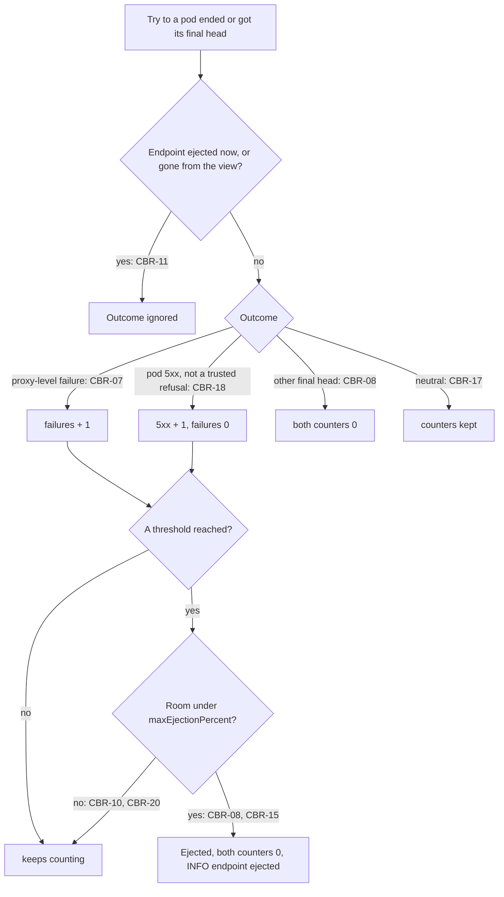
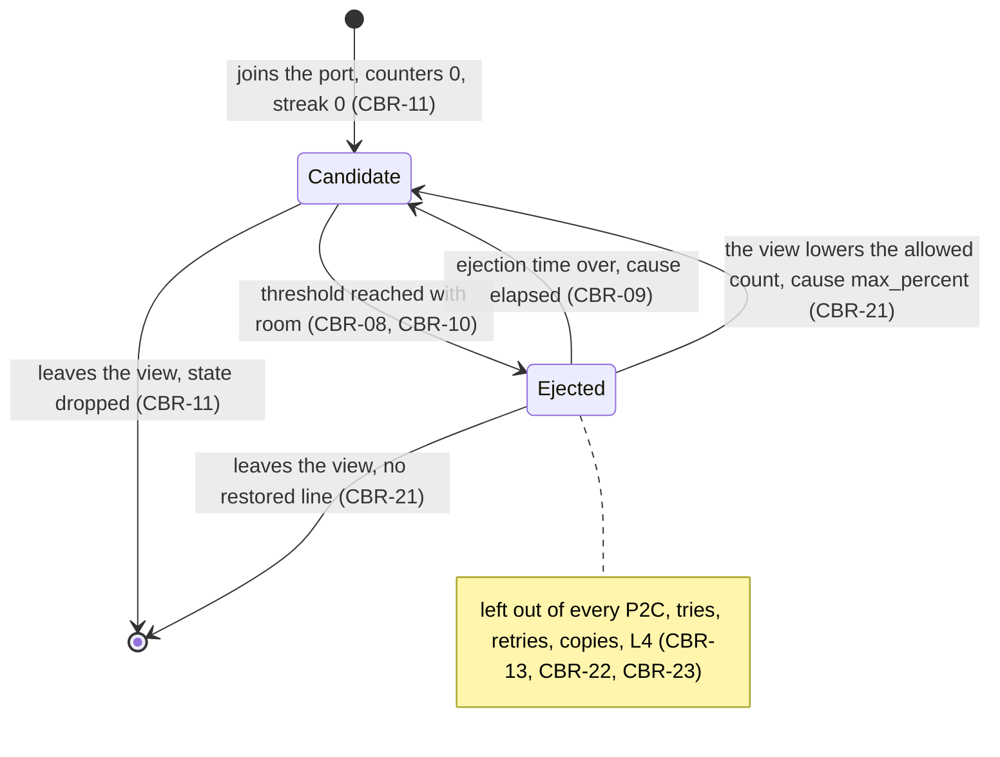
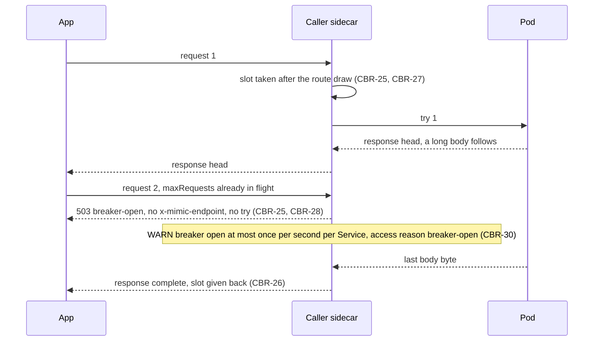

# M4: outlier detection and circuit breaker

> Retro page (#547) of [the mesh milestones](README.md). Issue #451. Spec: §4.1, §7
> (`MimicConfig`), §7.9 ("Outlier detection", "Circuit breaker", "Configuration", "Metrics"),
> §11.1, criteria §12.27. Design: [`../mimic-mesh.md`](../mimic-mesh.md) §3.2, §6, §9, §10, §14,
> §15. Fault injection, the other half of M4 (#452, `FLT-xx`), has its own page:
> [M4: fault injection](m4-faults.md).

## Goal

Two guards of the caller's sidecar, set by a `MimicConfig` on the Service and kept **per caller
pod**: **outlier detection** ejects a pod whose proxy-level failures pile up, for a growing
ejection time, from every choice of the sidecar (passive only: no active health check); the
**circuit breaker** bounds the requests in flight to a backend Service and answers the excess at
once with `503` `breaker-open`.

## Key decisions

| Decision | Reason | Where |
|---|---|---|
| The 5 s avoidance of M1 stays; ejection is a hard exclusion on top | Replacing avoidance would make a blackholed pod cost five connect timeouts instead of one | #451 decision 1, CBR-16 |
| `consecutiveFailures` counts connect failures (TLS included), trusted `app_refused`, resets before the head (any method) and `invalid-response`; any response head of the pod resets it | These say the pod is broken | #451 decision 2, CBR-07, CBR-08 |
| Neutral: trusted `overloaded` and `queue-timeout`, `refused_stream`, route timeouts, the app leaving, a copy's deadline | A busy pod is not a broken pod, and ejecting it moves its load onto its siblings; a timeout is the route author's bound; the app leaving is the app's doing | #451 decision 2, CBR-17 |
| `consecutive5xx` counts the pod's `5xx` heads that are not trusted refusals, off by default (`0`); a mirror copy's status is never read | A `5xx` is often caused further down the chain: ejecting on it can spread an outage | #451 decision 3, CBR-18, CBR-22 |
| At most `⌊n × maxEjectionPercent / 100⌋` ejected, no "at least one", at every instant | One pod at the default 50 % is never ejected; a view that shrinks the port restores the ejections that end first | #451 decision 4, CBR-10, CBR-11 |
| Ejection time `baseEjectionTime × 2^k`, at most 300 s; the streak ends after 300 s restored without a new ejection; no probe, no slow start on restoration | A flapping pod stays out longer; P2C least request already gives a restored pod only its share | #451 decision 5, CBR-09 |
| A pure state machine, `mimic-core` `mesh::outlier`, the clock passed in | Same pattern as the retry `Budget`: exhaustive and property tests without time | #451, CBR-07 to CBR-12 |
| `maxRequests` per caller pod and backend Service (all its ports), one slot per request from its first try to its last response byte, whatever its tries | The policy and the budget have the same unit; a request's retries are its own business | #451 decision 6, CBR-25 to CBR-27 |
| Held streams keep their slot; mirror copies, L4 connections, `Upgrade` and `CONNECT` take none | Copies have their own bounds (#450), and silent copies must never fill the breaker of a Service that also serves primary requests; L4 cannot be answered `503` | #451 decisions 6 and 7, CBR-26 |
| One atomic count per Service, no pending queue | Cheaper and simpler than a token or queue scheme; the wait already exists in the pool, under the route timeouts (Envoy-style pending queues lost) | #451 |
| `maxConnections` replaces the fixed 1024 HTTP/1 connections per pool (primary and mirror pools); HTTP/2 keeps 16 per pod | That is what the code enforced ("per pod" in the M1 text was wrong) | #451 decision 8, CBR-31 |
| `breaker-open`: `503`, no `x-mimic-endpoint`, no try, no budget deposit or ask, never retried, never recorded | It names no pod, so no sidecar ever trusts it | #451 decision 9, CBR-28 |
| Bounds: `consecutiveFailures` 1 to 100, `consecutive5xx` 0 to 100, `baseEjectionTime` 1 to 300 s, `maxEjectionPercent` 0 to 100, `maxRequests` and `maxConnections` 1 to 100 000; no `MIMIC_*` variable | Policy from the view only; CEL in the CRD and `validate` in the controller | #451 decision 10, CBR-04, CBR-05 |
| The bench bound is `consecutiveFailures + (connections in flight − 1)` requests per ejection, and the breaker budget is on the p99 of `duration_ms` | An ejection cannot recall the tries already sent when the fifth failure lands; one line can wait on a busy worker | #451 (autonomous, 2026-11-15), CBR-34 |

## Decision: what one try does to its endpoint

The thresholds are `consecutiveFailures`, and `consecutive5xx` when it is not 0. A try to the
original destination (a fallback, a stale view) has no pod and gives no outcome.

## Workflow: the life of an endpoint in one caller's sidecar

At the default `baseEjectionTime` of 30 s the ejections of one streak last 30, 60, 120, 240,
300, 300 … s. When every endpoint of a port is ejected (possible only at 100 %), a request is
answered `breaker-open`, an L4 connection is closed and a copy is an `error` (CBR-20, CBR-22).

## Sequence: the breaker of one backend Service

## Criteria

| Prefix | Range | What |
|---|---|---|
| `CBR` | `CBR-01` to `CBR-06` | policy defaults, view, converter, CRD and CEL, kind `msh_17`, fuzz seed |
| `CBR` | `CBR-07` to `CBR-14` | `mesh::outlier` outcomes, thresholds, ejection time, max percent, views (U, proptest), P2C and planner exclusion, criterion bench |
| `CBR` | `CBR-15` to `CBR-24` | sidecar: ejection, avoidance, neutral outcomes, `5xx` and trust, app refusals, all ejected, view changes, mirrors and L4, retries, labels and logs |
| `CBR` | `CBR-25` to `CBR-31` | breaker: `maxRequests`, what holds a slot, scope, accounting, changes, access `reason`, `maxConnections` |
| `CBR` | `CBR-32` to `CBR-36` | kind `cbr_32`, bench `mesh-eject` and `mesh-breaker`, docs, security review |

`CBR-37` to `CBR-49` are reserved for #451; fault injection (#452) uses `FLT-xx`. Budget of
design §14 (M4 row): ejection within 5 failing requests (bounded under concurrency as decided
above) and the breaker answering within 1 ms (p99 0 ms at 200 rps, 32 connections).

## Known limits

All in spec §11.1 (M4):

- **Outlier detection is per caller pod and passive**: a pod ejected by one caller is still
  tried by the others until they see its failures themselves; there is no active health check.
- **A pod can get itself ejected, not another**: failures are bound to the address of the try;
  a peer or a spoofed reset can eject an address for one ejection time (no identity check
  without mTLS, a non-goal).
- **One endpoint is never ejected at the default 50 %**: avoidance and the retries still apply.
- **The breaker is per caller pod and counts held streams**: a Service called by 10 pods with
  `maxRequests: 100` can see 1000 requests, and long-lived streams hold their slot; whoever may
  write a `MimicConfig` for the Service can throttle all its callers.
- With `consecutive5xx` on, downstream `5xx` can cascade (off by default, bounded by the max
  percent); over intercepted TLS a refusal is not trusted, so its `503` counts as a `5xx`.

## Open follow-ups

- #452: fault injection (delay and abort), [its page](m4-faults.md): an injected abort takes no
  breaker slot, an injected delay is waited inside the slot (spec §7.9 "Circuit breaker").
- #515 holds the non-blocking notes of the M4 bench review (#543): the `mesh-eject` verdict
  compares an average per ejection with a per-ejection bound, and the `mesh-breaker` percentage
  counts warm-up lines.
