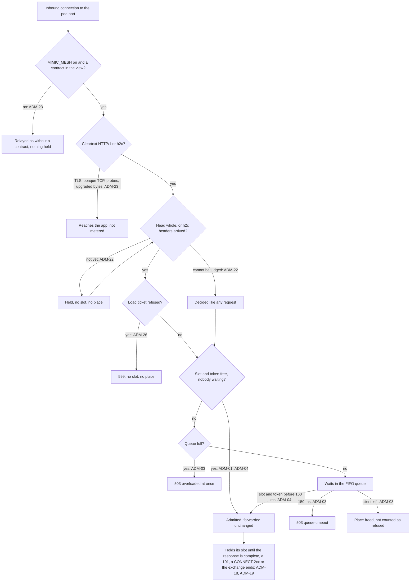
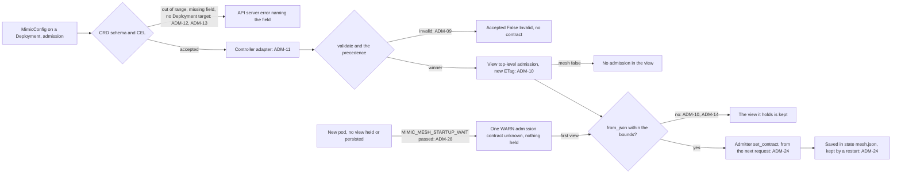
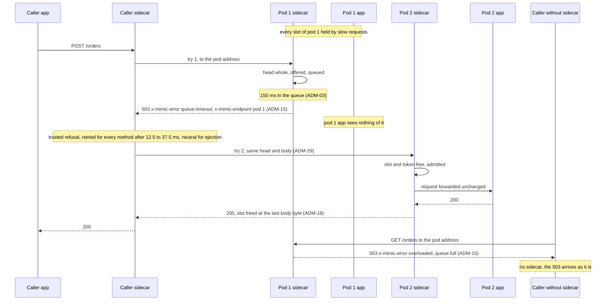
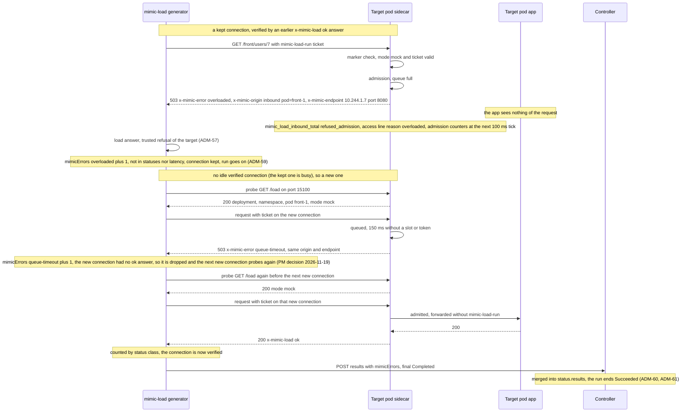

# M5: the admission contract in the inbound sidecar

> Page of [the mesh milestones](README.md), written with #453 (step 7). Issue #453. Spec: §4.1
> ("Admission contract", "Failures", "Overload", access `reason`), §7 (`MimicConfig.spec.admission`), §7.9
> (view `admission`, "Retries" for the callers), §9 (`synthetic`), §10.3 (`MIMIC_MESH`), §11.1, criteria
> §12.29. Design: [`../mimic-mesh.md`](../mimic-mesh.md) §8, §9, §12, §13, §14 (M5 row) and §15. The
> signalling of M5 (metrics, the line `admission contract changed`, dashboards, load tests counting refusals) is
> #454, in [Signalling (#454)](#signalling-454) below; autoscaling is #455.

## Goal

Protect an app from overload on its own side. With `MIMIC_MESH=on` and a view that holds an `admission`
contract, the inbound sidecar of each pod lets at most `concurrency` requests be in flight to its app and at
most `rps` requests per second reach it. What is over the contract waits in a short queue, then is refused
with a `503` the sidecar writes itself: the app never sees a byte of it, and a meshed caller's sidecar trusts
the refusal and retries it on another pod for every method. Without a contract nothing is held or refused.

## Key decisions

| Decision | Reason | Where |
|---|---|---|
| The contract is declared on a Deployment target (`spec.admission`, `concurrency` 1 to 100 000, `rps` 1 to 1 000 000, both required, no default) and enforced **per pod**, nothing shared between pods | The only stateless, coordination-free option, and what an HPA scales: more pods, more capacity (`replicas × contract`) | design §9, ADM-09, ADM-12, ADM-13 |
| Admitted when fewer than `concurrency` are in flight **and** a token is left in a bucket of rate `rps` and size `max(1, ⌈rps / 10⌉)`, full when the contract starts; either limit stops admission alone; integer nanoseconds, no float | The two limits of the contract; integer arithmetic keeps the pure state exact, and the extremes (100 000/1 000 000 over a 10-year clock) do not overflow | design §9, ADM-01, ADM-02 |
| A FIFO queue of `max(1, ⌈concurrency / 10⌉)` places, 150 ms at most; full → `overloaded` at once, 150 ms → `queue-timeout`; a new request is never admitted ahead of one waiting; neither the size nor the 150 ms is configurable | 10 % of the contract waits, the rest is refused; the owner keeps both bounds fixed | owner decision, design §9, ADM-03, ADM-04 |
| `mimic-core` `mesh::admission` is a pure state (`offer`, `release`, `cancel`, `apply`, `set_contract`, `next_instant`, `counts`), the sidecar's monotonic clock passed in; a clock that goes back frees nothing | Testable with `proptest` over any sequence of instants; no clock, I/O or random source in the core | spec §4.1, ADM-05, ADM-07, ADM-34 |
| The sidecar keeps one `Admitter` per pod (`mesh::admit`): the state behind one lock held for short sections only, a waiter per queued request, and one timer task alive while the queue is not empty that decides it at the instants the state gives | Drawn from the code: no task per request and no timer without a queue; the core bench bounds an offer and its release at 200 ns | ADM-08, ADM-30 |
| Metered: an HTTP/1 request once its head is whole, an `h2c` stream once its headers arrived. Not metered: inbound TLS, opaque TCP, the admin-port probes, upgraded bytes | The sidecar sees a request only where it reads HTTP in cleartext; inbound TLS is never decrypted | spec §4.1, ADM-23 |
| A request counts until its response is complete (last body byte and trailers, or the app's close), or until its exchange ends without one; a `101` and a `2xx` to `CONNECT` end it at that head, a `1xx` does not | What an app's worker holds; a long-lived response (SSE, a gRPC stream) holds its slot for its whole life, as it holds a worker | spec §4.1, ADM-18, ADM-19 |
| The load-marker check comes **before** admission: a request whose ticket is refused (`599`) takes neither a slot nor a place; a valid load request is queued and refused like any request | A refused ticket must take nothing; a load test must see the contract it tests | #453 decision, ADM-26 |
| HTTP/1: each request head is held whole before its first byte is forwarded, one request at a time, and forwarded unchanged once admitted; a head that is not whole holds neither a slot nor a place | The decision needs the whole head; a slow-loris client takes no slot | spec §4.1, ADM-21, ADM-22 |
| A head that cannot be judged (64 KiB without its end, unframed, stalled 30 s, cut) is decided like any request; admitted, it keeps its slot until its connection ends | Its response end is no longer seen; holding the slot means such heads are no way around the contract | #453 decision, ADM-22 |
| The refusal: `503 Service Unavailable` with exactly `x-mimic-error` (`overloaded` or `queue-timeout`), `x-mimic-endpoint` (the original destination as dialled), `x-mimic-origin: inbound; pod=<name>`, `content-length: 0`, and `connection: close` on HTTP/1 when the connection is not kept; no `date` | `x-mimic-endpoint` makes it a trusted refusal for the caller; the origin says where the answer comes from, as the `connect-failed` answer of #518 | #453 decision, ADM-15, ADM-16 |
| The refusal is written by the sidecar after the removal of the app's `x-mimic-*` fields, never relayed from the app | An app cannot forge a refusal through its own sidecar | spec §4.1, ADM-25, ADM-34 |
| HTTP/1 keep-alive is chosen **from the head**: kept for an HTTP/1.1 request without `Connection: close` and `Expect`, with no body or a `content-length` of at most 65 536; the answer is written at once and the body drained within 1 s; closed otherwise | Design §9 waited for the body first, which the 1 ms budget of design §14 does not allow | #453 decision, ADM-20 |
| On HTTP/1 the refusal waits for the answers to the earlier requests of the connection; on `h2c` the stream is answered, its body not read, the other streams go on | Pipelined answers keep their order; one refused stream costs nothing to its connection | spec §4.1, ADM-16, ADM-21 |
| A refusal is observed like any exchange the client saw: an access line with `reason` and no `upstream`, `mimic_http_requests_total`, `synthetic` for discovery; no component line per refusal | A mock never replays a refusal; the admission metrics, the INFO `admission contract changed` and the dashboards are #454 | #453 decision, ADM-27 |
| The contract follows the view without a restart: lowering cuts nothing, raising admits the waiting requests in order, a removed contract admits every waiting request, a new contract counts only what it admits; a stale view and a persisted view keep theirs | No request is cut by a configuration change, and a restart during a controller outage keeps the protection | spec §4.1, §7.9, ADM-06, ADM-24 |
| Before the first view there is no contract; one WARN `admission contract unknown` when `MIMIC_MESH_STARTUP_WAIT` passes without a view, held or persisted | A new pod is never blocked by a missing view, and the gap is visible | #453 decision, design §13, ADM-28 |
| Meshed callers retry the refusal on another pod for every method after 12.5 to 37.5 ms, within their retries and budget; the refusal is neutral for outlier detection | The app never saw the request, so any method is safe to send again; a busy pod is not a failing one | delivered with M2 and M4 (RTY-02, RTY-12, RTY-13, CBR-17), ADM-29, ADM-31 |
| No `MIMIC_*` variable, no RBAC and no capability are added: the contract comes from the view only | Same pattern as the other policy fields | ADM-34 |

## Decision: what one inbound request gets

A head that could not be judged and was admitted keeps its slot until its connection ends; refused, it is
answered with `connection: close` and nothing of it is forwarded (ADM-22).

## Workflow: from a `MimicConfig` to the contract of each pod

A lower `concurrency` cuts nothing and a higher one admits the waiting requests in order; a removed contract
admits every waiting request at once and stops holding heads (ADM-06, ADM-24).

## Sequence: a refusal retried on another pod, and a caller without a sidecar

## Criteria

| Prefix | Range | What |
|---|---|---|
| `ADM` | `ADM-01` to `ADM-08` | `mesh::admission`: the two limits, sizes and integer arithmetic, the queue and its 150 ms, FIFO, `proptest`, contract changes, counts, criterion bench |
| `ADM` | `ADM-09` to `ADM-14` | policy, view and `from_json`, controller adapter, CRD and CEL, kind `msh_17`, fuzz seed |
| `ADM` | `ADM-15`, `ADM-16`, `ADM-20`, `ADM-21`, `ADM-25` | the refusal on HTTP/1 and `h2c`, the connection after it, pipelining, stripping and refusals together |
| `ADM` | `ADM-17` to `ADM-19`, `ADM-22`, `ADM-23` | the contract enforced at twice its load, the slot until the response is complete, upgrades, held heads and slow-loris, what is not metered |
| `ADM` | `ADM-24`, `ADM-26` to `ADM-28`, `ADM-30` | the contract following the view, the load marker, access line and discovery, the unknown contract, `SIGTERM` |
| `ADM` | `ADM-29`, `ADM-31` | callers retry on another pod: in process, and kind `adm_31` |
| `ADM` | `ADM-32` | benchmark setup `mesh-admission` (design §14 M5 row), run by hand and recorded on #453 |
| `ADM` | `ADM-33`, `ADM-34` | documentation review, security review |

`ADM-35` to `ADM-49` are reserved for #453; #454 continues at `ADM-50`.

## Known limits

All in spec §11.1 (M5, #453):

- **The contract is per pod and does not tell callers apart.** Each sidecar admits from what it sees itself;
  the workload's capacity is `replicas × contract` and nothing is shared between pods. One caller, or one
  attacker that can reach the pod IP, can take every slot and token, and the other callers are then refused
  too. Admission protects the app from overload; it is no access control (NetworkPolicy is) and does not keep
  callers fair to each other. A meshed caller retries a refusal on another pod within its retries and its
  budget; a caller without a sidecar gets the `503`.
- **Some traffic is not metered.** Inbound TLS (never decrypted), opaque TCP, the admin-port probes and the
  bytes after a `101` or a `CONNECT` reach the app without the contract. A workload that serves HTTPS on its pod
  port has no admission control; the contract's author must size it for what it does meter.
- **Held slots follow the slowest side.** A long-lived response, a client that sends its body slowly or one that
  reads its response slowly keeps its slot for as long as that lasts, as it would keep one of the app's workers.
  A client holds nothing while its head is incomplete (at most 64 KiB, up to the 30 s stall restarted at each
  byte, within `MIMIC_MAX_CONNECTIONS`), so a slow-loris client takes no slot; `concurrency` slow admitted
  requests can still starve the contract of that pod.
- **A head that cannot be judged keeps its slot until its connection ends.** Over 64 KiB, unframed, stalled or
  cut: its response end is no longer seen. A client that sends them takes slots of its own pod only, as long as
  it keeps those connections.
- **The contract can be briefly unknown or exceeded.** A new pod has no contract until its first view (one WARN
  `admission contract unknown` after `MIMIC_MESH_STARTUP_WAIT`); a restarted sidecar container keeps the
  contract of its persisted view. A contract added while requests are in flight counts only the requests
  admitted after it, so the app may serve up to `concurrency` more while the earlier ones last; a lowered
  contract lets the requests in flight finish.
- **HTTP/1 timing changes under a contract.** Each request head is held until it is whole and admitted: up to
  150 ms in the queue, plus the wait for the answers to the earlier requests of a pipelined connection; an
  `Expect: 100-continue` request is held before the app can answer `100 Continue`. Bytes are not changed. A
  refused request's body, up to 64 KiB within 1 s, is read and discarded, and the requests pipelined behind it
  wait for that read.
- **The refusal names the pod.** `x-mimic-endpoint` and `x-mimic-origin` give the pod address the caller dialled
  and the pod name, as the `connect-failed` answer of #518 does. A caller that reached the pod already knows its
  address, and the pod name is not a secret.

## Signalling (#454)

Issue #454, criteria `ADM-50` to `ADM-66` (spec §12.29 "M5 signalling"). Spec: §4.1 ("Admission contract":
"Observability", "Signals"), §7.8 ("Sidecar", "Generator", "Results"), §7.9 ("Admission": `admission contract
changed`), §9 (the reasons table, the attempt outcomes, the `mimic_admission_*` rows), §9.1 (`mimic-sidecar` rows
*Mesh* and *Admission*, `mimic-mock-load` "Admission by result") and §11.1 (M5, #454).

| Decision | Reason | Where |
|---|---|---|
| The sidecar reads the counts of `mesh::admission` once every 100 ms on one timer, advances the two counters by their deltas and sets the gauges; nothing on the request path | The ADM-32 headroom: the request path gains no lock, counter or allocation | #454 decision, spec §4.1 "Signals", ADM-53, ADM-64 |
| `mimic_admission_requests_total{result}`: `admitted` is every admission, `queued` the offers that waited, `cancelled` a client that left while queued; demand is `admitted + overloaded + queue-timeout` | The four end results add up to the offers (ADM-05); a client that left is not demand | #454 decision, ADM-53 |
| `utilization = max(avg(in flight) / concurrency, avg(demand) / rps)`, each average an EWMA of time constant 15 s whose weight `1 − e^(−Δt / 15 s)` follows the real tick interval; not capped | A scrape every ~15 s does not alias 1 s noise, and refused demand above 1 lets #455 grow by more than one step | design §11, `mesh::utilization`, ADM-52, ADM-54 |
| The gauges exist only while a contract is in force; the averages start at 0 with a new contract, are kept when its values change, dropped when it is removed | An HPA reading a pod without a contract sees no metric rather than 0 | #454 decision, ADM-52, ADM-53 |
| One INFO `admission contract changed` per change of the contract in force, persisted view at start included, with two integers, their previous values and the ETag | A contract change is visible without a line per refusal | spec §7.9, ADM-55 |
| One reasons table (§9): `mesh::reason::Reason` is the `x-mimic-error` value, the access `reason`, the metric labels and the `mimicErrors` keys; the attempt outcomes keep their M2 spelling (`queue_timeout`), mapped and tested | One string in three places; renaming the outcomes would break the queries written since M2 | #454 decision, ADM-50, ADM-51 |
| `mimic_load_inbound_total` gains `refused_admission`; `forwarded` counts only what reached the app | A load request refused by the contract did not reach the app | #454 decision, ADM-56 |
| The generator trusts only an inbound refusal bound to the target's pod and address (`overloaded`, `queue-timeout`, `connect-failed`, one `x-mimic-origin: inbound; pod=<target>`, one `x-mimic-endpoint` equal to the address dialled); any other answer without `x-mimic-load: ok` is still `Unverified` | A load test must measure a contract; a refusal from elsewhere still stops the run | #454 decision, `load::answer`, ADM-57, ADM-59 |
| A refusal goes to a new `mimicErrors` map by reason; it counts in `requests` and `rps`, not in `statuses` nor `latencyMicros`; the field is left out when empty | The statuses and the latency stay those of the app; F11 results keep their bytes | #454 decision, `load::summary`, ADM-58, ADM-60 |
| A refusal never verifies a target: on a connection already verified by an `x-mimic-load: ok` answer it is counted and the connection kept; as the first answer of a new connection it is counted, the connection dropped, and the next request probes again | The marker answer proves the pod is in mock; a refusal proves only that a mimic sidecar answered | PM decision of 2026-11-19 on #454 (safety), ADM-66 |
| No pause after a refusal in the closed model | The load stays on the deployment under test; the wiki points to the open model | #454 decision, spec §11.1 |

### Sequence: a load test meets a refusal

An answer that names another pod or address, a repeated field, a `500` or `breaker-open` is still `Unverified`
and stops the run (ADM-57, ADM-59). In the closed model the worker sends its next request at once after a
refusal (spec §11.1).

### Known limits of #454

All in spec §11.1 (M5, #454):

- **Lifted:** a load test no longer stops at the first admission refusal (#453's limit); the generator counts the
  inbound refusals of its targets under their reason.
- **A server that passes the probe can pass refusals off as its own.** No signature binds a refusal, nor
  `x-mimic-load: ok`, to the sidecar. Such a server can already answer `ok`, so a forged refusal gains it nothing:
  its load stays within the run's rate and concurrency, and the answers are counted in `mimicErrors`. The app
  behind a real sidecar cannot forge one.
- **A closed-model load test against a refusing pod spins**: refusals come back at once and the workers send again
  at once, within the run's concurrency. Use the open model to check a contract.
- **Callers drive the utilisation.** It counts refused demand, uncapped by design: any client that can reach a pod
  IP, and a namespace writer that lowers the contract, raise it, and an HPA on it (#455) can be driven to its
  `maxReplicas`. NetworkPolicy and `maxReplicas` bound it; the app moves only its own pod's signal.
- **The admission metrics lag by up to 100 ms and miss the last tick at exit.** The access lines and
  `mimic_http_requests_total` count every refusal at once.

## Open follow-ups

- #455: autoscaling.
- Out of scope: a configurable queue or timeout (owner decision); a contract per caller, per route or shared
  between pods; inbound TLS. Mesh traffic management beyond the milestones of the design is v2.
