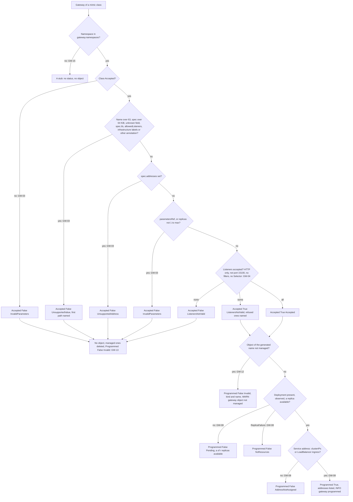
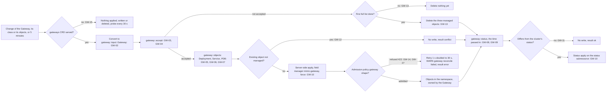
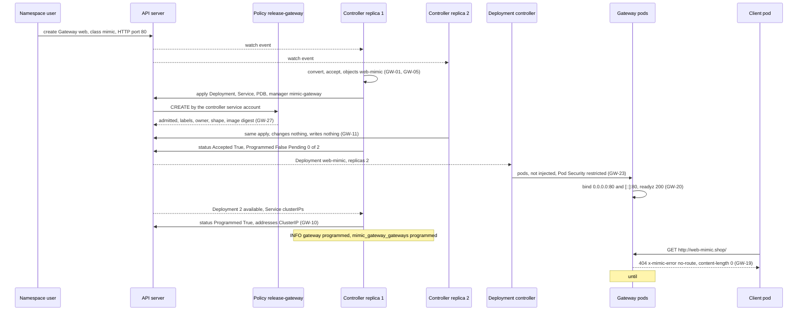

# M6: the GatewayClass `mimic` and the Gateway reconciler

> Page of [the mesh milestones](README.md), written with #456 (step 8). Issue #456. Spec: §2 (components,
> prerequisites), §7.10 "The mimic Gateway", §9 (the `mimic_gateway_*` rows, `component="gateway"`), §10.2
> (`MIMIC_GATEWAY_*`), §10.3 (`MIMIC_ROLE`, `MIMIC_GATEWAY_PORTS`, the two timeouts), §11 (gateway RBAC), §11.1
> (M6), criteria §12.30. Design: [`../mimic-mesh.md`](../mimic-mesh.md) §5 and §15. The routing of the attached
> `HTTPRoute`s is #457 (`GW-40` to `GW-69`); HTTPS listeners are #458 (`GW-70` and after).

## Goal

Bring north-south traffic into the cluster through the Gateway API. A `Gateway` of a class whose `controllerName`
is `mimic.platform.io/gateway-controller` gets, in its own namespace, a gateway `Deployment`, `Service` and
`PodDisruptionBudget`. The gateway pods run `mimic-sidecar` in the gateway role. The controller writes the standard
Gateway API status of the class and of the Gateway. In #456 the gateway pods answer every request `404`
`x-mimic-error: no-route`: #457 adds the routing with the mesh client, and #458 adds TLS termination.

## Key decisions

| Decision | Reason | Where |
|---|---|---|
| The gateway is off by default; `gateway.enabled` needs `mesh.enabled`, `image.digest`, a non-empty `gateway.namespaces` and the Gateway API CRDs at install, else the chart fails with a message that names the missing one | The data plane is the mesh client; the admission policy pins the image by digest; the RoleBindings need the namespaces | spec §7.10 "Enabling", GW-21, GW-22 |
| The generated names follow GEP-1762: `<gateway>-mimic`, else a hashed form (`.` to `-`, a `g` prefix, cut to 46 characters, the first 10 hex digits of the SHA-256 of the name, `-mimic`) | One standard name that a user can predict, and a valid DNS-1035 label of at most 63 characters for any Gateway name | *autonomous*, #456, GW-01 |
| `spec.infrastructure` labels and annotations other than `mimic.platform.io/replicas` are refused (`UnsupportedValue`), not propagated | No cloud load balancer annotation reaches the Service; a Gateway is never applied in part | *autonomous*, #456, GW-03 |
| `allowedRoutes.namespaces.from: Selector` is refused | It needs a cluster-wide Namespace read, which the controller does not get | *autonomous*, #456, GW-04 |
| A Gateway outside `gateway.namespaces` gets no status and no object; the controller keeps only a stub (namespace, name, class) of it and of the Gateways of other classes | The cluster admin opts namespaces in; the controller has RBAC only there, and unlisted namespaces cannot load the reconciler (#576; it was `NamespaceNotAllowed`) | *autonomous*, #456, #576, GW-03, GW-15 |
| A Gateway that is not accepted has no objects; its managed objects are deleted | Nothing half-applied runs at the edge | *autonomous*, #456, GW-07, GW-13 |
| Ports below 1024 through the safe, namespaced sysctl `net.ipv4.ip_unprivileged_port_start=0`, not a port remap and not a capability | Pod Security `restricted` permits it; the container port is the listener port | *autonomous*, #456, GW-05, GW-23 |
| The replica count comes from the annotation only (default `min(2, MIMIC_GATEWAY_MAX_REPLICAS)`, 1 to the max); no HPA in M6 | The apply forces the count, so an HPA would fight it | *autonomous*, #456, GW-03, GW-05 |
| The pure parts (`gateway::input`, `gateway::accept`, `gateway::objects`, `gateway::status`) are in `mimic-core`; the controller does the Kubernetes I/O; the gateway role is plumbing in `mimic-sidecar` | `mimic-core` stays pure: the time of the status is passed in, and the objects are `serde_json::Value` with sorted keys | spec §7.10, GW-01 to GW-09 |
| Both controller replicas reconcile (no leader); objects and status go by server-side apply, field manager `mimic-gateway`, `force: true`; the status is sent only when it differs | An apply that changes nothing writes nothing, so two replicas converge without a resource version change | spec §7.10, GW-10, GW-11 |
| An object is managed when it has `app.kubernetes.io/managed-by: mimic` and `mimic.platform.io/gateway: <gateway>`; an object of the generated name that is not managed is never changed or deleted | The controller never takes over an object that a user made | spec §7.10, GW-12, GW-25 |
| Nothing is deleted before the first full list of `gateways`, `deployments` and `services`, and nothing while the `gateways` CRD is absent | No deletion on a partial picture | spec §7.10, GW-13, GW-15 |
| A failed request is retried after 1 s, doubled up to 30 s, with one WARN `gateway reconcile failed` per Gateway and streak; the `error` is the status reason and code only | Bounded load on the API server; no object body in a log | spec §7.10, GW-14 |
| A status message holds only field paths, annotation keys and identifiers that the API server validated and bounded; never a hostname, an annotation value or another `spec` value | No user value reaches a log, a metric label or a status | spec §7.10 "Status", GW-03, GW-17 |
| RBAC: cluster-wide read of `gateways` and `gatewayclasses` and `patch` of their `status`; writes of `deployments`, `services` and `poddisruptionbudgets` through a ClusterRole bound by one RoleBinding per listed namespace | Writes stay in the namespaces that the cluster admin listed | spec §11, GW-21, GW-26 |
| A `ValidatingAdmissionPolicy` `<release>-gateway` limits the writes of the controller to labelled objects of the fixed shape, by key allowlists, exact label sets and no added annotation (`gateway.admittedAnnotations` for platform webhooks) | RBAC cannot narrow `create`, `patch` and `delete` to labelled objects; an allowlist also refuses the fields of later Kubernetes versions (#575) | spec §7.10 "Admission policy", §11.1, GW-27 |
| The gateway pod has no token, no capability, no volume and no host access; UID 65532; Pod Security `restricted`; never injected | The listeners face clients that mimic does not trust | spec §7.10, §11, GW-05, GW-23 |
| The listeners are bounded: `MIMIC_MAX_CONNECTIONS` from `gateway.maxConnections` (1024), a 64 KiB head within `MIMIC_GATEWAY_HEADER_TIMEOUT` (10 s, HTTP/2 too), `MIMIC_GATEWAY_IDLE_TIMEOUT` (60 s), 100 HTTP/2 streams, 64 KiB windows; the cap × 96 KiB + 32 MiB fits `limits.memory` (192Mi) | Untrusted clients cannot hold the gateway or push it out of its memory limit (#574) | spec §7.10 "Gateway role", GW-19, GW-28 |
| The gateway checks run in their own kind script `scripts/e2e-gateway.sh` and CI job `e2e-gateway`, on Kubernetes 1.33 and the latest that kind supports | `scripts/e2e.sh` has no time left, and its `msh_28` and `rte_*` sections delete the CRDs | GW-23 |

## Decision: the status of one Gateway

A `ReplicaFailure` condition applies only after the checks of a missing Deployment, a generation behind and no
available replica (§7.10 "Status").

## Workflow: from a Gateway to its objects

Orphaned managed Deployments and Services, whose `mimic.platform.io/gateway` names no Gateway of their namespace,
are deleted with their PodDisruptionBudget (GW-13). A Gateway deletion is otherwise left to the garbage collector.

## Sequence: a Gateway is created and programmed

## Criteria

| Prefix | Range | What |
|---|---|---|
| `GW` | `GW-01` | generated names, GEP-1762 and the hashed form, `proptest` |
| `GW` | `GW-02` | the conversion of a `Gateway` to `gateway::input::Gateway` |
| `GW` | `GW-03`, `GW-04` | `gateway::accept`: the Gateway and the listeners |
| `GW` | `GW-05` to `GW-07` | `gateway::objects`: the golden Deployment, Service and PodDisruptionBudget, `proptest` |
| `GW` | `GW-08`, `GW-09` | `gateway::status`: `Programmed`, writing, `lastTransitionTime` |
| `GW` | `GW-10` to `GW-17` | the controller in process with a fake API: apply, two replicas, ownership, deletion, failures, CRD presence, configuration, metrics |
| `GW` | `GW-18` to `GW-20` | the gateway role of `mimic-sidecar`: configuration, answers and bounds, readiness and shutdown |
| `GW` | `GW-21`, `GW-22` | the chart (`scripts/check-chart.sh`) |
| `GW` | `GW-23` to `GW-28` | kind (`scripts/e2e-gateway.sh`): programmed, lifecycle, refusals, RBAC, the policy, the data path skeleton |
| `GW` | `GW-29`, `GW-30` | documentation review, security review |

`GW-31` to `GW-39` are reserved for #456; #457 continues at `GW-40`, #458 at `GW-70`.

## Known limits

All in spec §11.1 (M6, #456):

- **A Gateway writer gets a Deployment and an exposed Service.** Whoever can create a `Gateway` of the class
  `mimic` in a listed namespace gets pods of the fixed shape and a Service of `gateway.serviceType`, even without
  RBAC on Deployments or Services. The namespace `ResourceQuota` counts the pods and `gateway.maxReplicas` bounds
  one Gateway; only a quota on `count/gateways.gateway.networking.k8s.io` bounds the number of Gateways.
- **The admission policy checks the shape, not the intent.** It reads no Gateway. A stolen controller token can
  create, scale to `gateway.maxReplicas`, change the ports of or delete gateway objects of the fixed shape in the
  listed namespaces, and write any Gateway or GatewayClass status. It cannot run another image or command, mount a
  volume, use the host, add a capability, or take over or delete an object without the labels of mimic.
- **The namespace is the trust domain of a Gateway.** A namespace user can label pods so that the gateway Service
  sends them traffic, edit the generated objects (the next apply restores the fields of mimic), or take a generated
  name first. Each needs rights that already reach the pods and Services of the namespace.
- **Not propagated, not supported.** `spec.infrastructure` labels and annotations, `spec.addresses`, `spec.tls`,
  ListenerSets and `allowedRoutes.namespaces.from: Selector` make the Gateway or the listener not accepted. A
  `ListenerSet` that names a mimic Gateway gets no status from mimic. No `SupportedVersion` condition: the controller
  reads no CRD.
- **No autoscaling of gateways.** The apply forces the replica count: an HPA or a `kubectl scale` is undone at the
  next reconcile, at least every 5 minutes.
- **Disabling and unlisting leave objects.** The controller then has no RBAC in the namespace: the gateway objects
  keep running without reconcile until their Gateway is deleted. The status that mimic wrote stays after
  `helm uninstall`.
- **Upgrades roll every gateway.** A new image digest, new `gateway.resources` or a new gateway variable changes
  every pod template. During a chart upgrade the new policy refuses the applies of an old controller replica with the
  old digest (`error`) until it is replaced.
- **The gateway names itself.** Its no-match answer carries `x-mimic-error: no-route` to any client, so an outside
  client learns that the edge is mimic.

## Open follow-ups

- #457: the HTTP data plane: route attachment (`attachedRoutes`), the gateway view and request routing with the mesh
  client.
- #458: HTTPS listeners, certificates and `ProtocolConflict`.
- Out of scope (§11.1, v2): GRPCRoute, TLSRoute, TCPRoute, UDPRoute, ListenerSets, `spec.addresses`, the
  propagation of `spec.infrastructure`, and an HPA on gateways.
