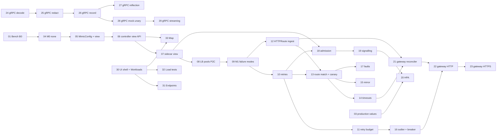

# Mimic mesh — design

> Status: **design, 2026-11-12**. Audience: mimic engineers and the product owner. This
> document explains *what* we build next and *why*; the observable contract of each step is
> written into `docs/SPEC.md` (§3 to §11 and the acceptance criteria of §12) by the issue that
> delivers it, and the spec stays the source of truth. The product decisions recorded on
> 2026-11-12 are final and are not discussed here; where this document makes a technical
> choice, it says why the alternatives lost.

## Contents

1. Goals and non-goals
2. Modes: `none`, `discovery`, `mock`
3. Architecture of the mimic mesh
4. Service discovery and the scoped view
5. Gateway API usage
6. The `MimicConfig` CRD
7. Retries
8. Ingress behaviour
9. Admission control
10. Failure signalling, metrics and logs
11. Autoscaling
12. Interaction with mock mode and load tests
13. Failure modes
14. Performance budgets
15. Security notes
16. Multi-cluster, kept in mind
17. Parallel tracks: gRPC, explorer UI, benchmarks, production values, small items
18. Milestones and dependency graph

---

## 1. Goals and non-goals

**Goals.** Turn the sidecar that mimic already injects into a small, opinionated *mimic mesh*
for HTTP traffic between workloads, without a second proxy and without a change to the app:

- caller-side routing and client-side load balancing over pod IPs, with per-pod connection
  pools, power-of-two-choices (P2C) least-request and slow start;
- Service-level canary (weighted `backendRefs`), mirroring and timeouts from the Gateway API
  `HTTPRoute` (GAMMA: `parentRefs` a Service);
- retries of proxy-level failures, outlier detection and a circuit breaker, fault injection,
  declared in mimic's own `MimicConfig` CRD;
- an admission contract per workload (concurrency **and** requests per second) enforced by the
  callee's sidecar, with explicit `503` signalling, and a metric an HPA can scale on;
- a north-south gateway (`GatewayClass` `mimic`) that reuses the same client;
- a new default mode `none`: a plain proxy that records nothing.

**Non-goals** (v2 of the mesh or never): mTLS, workload identity and authorization policies;
multi-cluster (only a `cluster` field is kept in mind, §16); Gateway API experimental channel;
`GRPCRoute`, `TLSRoute`, `TCPRoute`, `UDPRoute`; locality/zone-aware routing; rate limiting
across pods (the contract is per pod, §9); app-status retries (`5xx`); traces (logs and metrics
only, as everywhere in mimic); a general-purpose service mesh feature set.

## 2. Modes: `none`, `discovery`, `mock`

| Mode | Inbound | Outbound | TLS | Pushes to the controller |
|---|---|---|---|---|
| `none` (**new default**) | forwarded, not recorded | forwarded (mesh-routed when in scope), not recorded | passed through, never intercepted | none |
| `discovery` | forwarded, recorded | forwarded (mesh-routed when in scope), recorded | §5 of the spec, unchanged | reports, as today |
| `mock` | forwarded, recorded | HTTP answered from recordings (§8 of the spec, unchanged) | unchanged | reports, as today |

- `MimicWorkload.spec.mode` gains `none` and its CRD default becomes `none`. Objects created
  before the change keep the `discovery` the API server wrote at their creation (defaults are
  persisted on write), so an upgrade does not silently stop recording. A deployment injected by
  label without any `MimicWorkload` is in `none` (it was `discovery`): an upgrade note in the
  changelog says so.
- Effective mode across several `MimicWorkload`s: `mock` > `discovery` > `none` (pure,
  `mimic-core` `mock::effective`, extended).
- In `none` the sidecar still installs trust (the webhook is unchanged), still pulls its mode
  and, from M1, its mesh view, so that switching to `discovery` needs no restart. It does not
  intercept TLS (nothing would read the plaintext), does not run the recorder, holds no
  samples and ships nothing. The mesh (§3) is independent of the mode: it works the same in
  `none` and `discovery`; in `mock` the mocked calls bypass it (§12).
- Why `none` passes TLS through: interception costs CPU, a handshake and a trust dependency for
  no benefit when nothing is recorded. The alternative (intercept in every mode to route
  HTTPS per request) was rejected: in-cluster mesh traffic is cleartext in the vast majority of
  cases, and HTTPS to an in-scope Service is still load balanced per connection (§3.3).

## 3. Architecture of the mimic mesh

```
 ┌─────────── caller pod ───────────┐            ┌──────────── callee pod ────────────┐
 │ app ─▶ iptables ─▶ mimic-sidecar │── pod IP ─▶│ iptables ─▶ mimic-sidecar ─▶ app    │
 │        (outbound 15001)          │            │ (inbound 15006): admission (§9)     │
 │   route (HTTPRoute) ─▶ backend   │            │  no re-route, app 503 passed through │
 │   Service ─▶ P2C over pod IPs    │            └─────────────────────────────────────┘
 │   pools · retries · breaker      │
 └──────────────▲───────────────────┘
                │ long-poll GET /v1/workloads/<dep>/mesh (sidecar API, HTTPS, token)
      ┌─────────┴───────────┐  watch  ┌──────────────────────────────────────────────┐
      │  mimic-controller   │◀────────│ Services · EndpointSlices · HTTPRoutes ·      │
      │  view = f(objects)  │         │ ReferenceGrants · MimicConfigs · Gateways     │
      └─────────────────────┘         └──────────────────────────────────────────────┘
```

### 3.1 Where routing happens

Routing and load balancing happen **in the caller's sidecar** (like Linkerd): the outbound
listener knows the original destination (`SO_ORIGINAL_DST`), which for a call to a Service is
its ClusterIP and port (kube-proxy rules live on the node, not in the pod's network namespace,
so the sidecar sees the ClusterIP before any DNAT). The sidecar looks the pair up in its view:

1. **Not in the view** (outside the scope, an external host, a pod IP, a headless Service):
   forwarded to the original destination exactly as today, byte-exact for HTTP/1. No route,
   retry, breaker or fault applies. Counted as `mesh="false"` (§10).
2. **In the view, HTTP** (cleartext, or TLS intercepted in `discovery`/`mock` passthrough): the
   request is parsed by `hyper`, matched against the HTTPRoute rules attached to the Service
   (§5), a backend Service is drawn by weight, a pod of that backend is chosen by P2C, the
   request goes over that pod's pool, with the MimicConfig policies of the backend (timeouts,
   retries, breaker, faults).
3. **In the view, not HTTP** (opaque TCP, TLS passed through, an HTTP/1 `Upgrade` or
   `CONNECT`): **connection-level** balancing: one pod is chosen by P2C per connection, then
   the bytes are relayed as today; a connect failure is retried on another pod (§7).

The callee's sidecar never re-routes (§8).

**Technical choice: HTTP/1 is re-framed for mesh-routed calls.** Per-request balancing, routing,
retries and pools are impossible with the per-connection byte relay of the spec (§4.1), so an
in-scope HTTP/1 call goes through `hyper`'s HTTP/1 client (header case preserved with
`preserve_header_case`, no header added). The spec gains an accepted limit: for mesh-routed
HTTP/1 calls, framing is re-done (chunk extensions and `obs-fold` are not kept, pipelined
requests are serialised, keep-alive is per hop). Everything not in the view keeps the byte
relay. Alternatives rejected: per-connection balancing only (no canary per request, no retry,
poor spread with keep-alive clients); writing our own pooled HTTP/1 client on the codec (more
code and risk than `hyper`, which we already ship).

### 3.2 Client-side load balancing

Pure logic in `mimic-core` (`mesh::lb`), clock and random numbers passed in:

- **Endpoints**: the ready addresses of the backend's EndpointSlices for the Service port
  (`ready: true`; `serving && terminating` only when no endpoint is ready, as kube-proxy does).
- **P2C least-request**: draw two distinct endpoints at random, take the lower
  `(in_flight + 1) / weight` (ties: the first draw). With one endpoint, take it. Outlier-ejected
  endpoints are excluded (§6.4).
- **Slow start**: an endpoint first seen ready at `t0` has weight
  `max(0.1, min(1, (now − t0) / window))`, `window` 30 s by default (`MimicConfig`
  `loadBalancer.slowStart`, `0s` disables). The sidecar's own start does not count as "first
  seen": at the first view every endpoint has full weight, so a restarted caller does not starve
  a stable backend.
- **Pools** (sidecar, `mesh::pool`): one pool per (pod IP, port, protocol). HTTP/2 (the app
  spoke h2c or gRPC): one multiplexed connection, a second one when the peer's
  `MAX_CONCURRENT_STREAMS` is reached. HTTP/1: up to `circuitBreaker.maxConnections` (default
  1024) connections per pod, idle ones closed after `MIMIC_MESH_POOL_IDLE_TIMEOUT` (90 s). The
  upstream protocol is the one the app spoke (no h1→h2 upgrade). Endpoints that leave the view
  have their pool drained: in-flight requests finish, idle connections close.
- Why P2C least-request: it is what Linkerd and Envoy use by default, needs only local state,
  and behaves well under uneven latencies; round robin and random lost (no load feedback),
  EWMA latency (Linkerd's "peak EWMA") lost because it needs tuning and gives little more for
  our traffic levels.

## 4. Service discovery and the scoped view

### 4.1 What the controller watches

Both controller replicas run `kube-runtime` reflectors (no leader, every step idempotent, as
today) on: `Service`, `EndpointSlice` (`discovery.k8s.io/v1`), `HTTPRoute` and
`ReferenceGrant` (`gateway.networking.k8s.io`, when the CRDs exist), `MimicConfig`,
`MimicWorkload`, and from M6 `GatewayClass` and `Gateway`. Only metadata and the fields used are
kept in memory (selectors and annotations dropped).

### 4.2 The scope of one sidecar

A sidecar of deployment `d` in namespace `n` receives the **view** of `(n, d)`:

- every Service of `n`;
- every Service declared in `spec.destinations` of the `MimicConfig`s that target `d`;
- every Service referenced as a `backendRef` or mirror of an HTTPRoute attached to one of the
  above (closure depth 1: the backends' own routes are not followed — GAMMA routes once, at
  the caller);
- the routes attached to those Services that apply to callers in `n` (producer routes, in the
  Service's namespace, apply to every caller; consumer routes, in `n`, apply only to `n`);
- the policies of `MimicConfig`s targeting those Services, and the admission contract of `d`.

The view is a **pure function** of the watched objects (`mimic-core` `mesh::view`), serialised
as canonical JSON (`BTreeMap`, sorted keys), with an `ETag` = format + SHA-256 of the bytes, so
two replicas with the same objects serve byte-identical views. Draft:

```json
{"format": 1, "cluster": "local", "mode": "none",
 "admission": {"concurrency": 64, "rps": 200},
 "services": {"shop/cart": {
    "ips": ["10.96.12.7"], "ports": {"80": {"name": "http", "targetPort": "http"}},
    "endpoints": {"80": [{"ip": "10.244.1.17", "port": 8080, "ready": true, "zone": "a"}]},
    "routes": [{"name": "shop/cart-canary", "rules": [<compiled HTTPRoute rule>]}],
    "policy": {"retries": {...}, "outlierDetection": {...}, "circuitBreaker": {...},
               "loadBalancer": {...}, "faults": [...]}}}}
```

Bounds (controller variables, each refused value → exit 2): at most
`MIMIC_MESH_MAX_SERVICES` (1024) services and `MIMIC_MESH_MAX_ENDPOINTS` (10 000) endpoints per
view, `MIMIC_MESH_MAX_VIEW_BYTES` (4 MiB). Over a bound, the services of `n` come first, then
declared destinations in name order; the rest is left out, counted
(`mimic_mesh_view_truncated_total`) and logged once per view change, and those Services fall
back to the out-of-scope path.

### 4.3 How the view reaches the sidecar

`GET /v1/workloads/<deployment>/mesh?format=1` on the existing sidecar API (§7.2 of the spec:
same TLS, projected token, `TokenReview` cache, per-source rate limit, a pod reads its own
deployment only), as a **long-poll**: with `If-None-Match` equal to the current ETag the
controller holds the request until the view changes or `MIMIC_MESH_WATCH_TIMEOUT` (30 s)
passes (`304`). Changes are coalesced for `MIMIC_MESH_DEBOUNCE` (100 ms). Views are cached per
`(n, d)` key and shared between deployments with identical inputs. Held requests have their own
budget, `MIMIC_SIDECAR_API_MAX_WATCHES` (10 000), separate from the connection cap of the other
endpoints (a full watch budget answers `503` + `Retry-After`, never starves pushes or TLS).

From M1 the view also carries the **mode**, so a mode change reaches every pod within about one
second instead of one `MIMIC_EGRESS_PULL_INTERVAL`; the egress pull remains for the snapshot.

Alternatives rejected: an xDS/gRPC stream (protobuf toolchain, `tonic`, a protocol we would only
half implement); a controller-initiated push to every sidecar (needs a listener and
authentication on every sidecar, and N outbound connections from each replica); a plain periodic
pull (seconds of stale endpoints during rollouts). Long-poll keeps the existing authenticated,
sidecar-initiated channel and gives push-like latency.

### 4.4 Destinations outside the scope

A call to a Service that is neither in `n` nor declared is **forwarded to its ClusterIP as
today** (kube-proxy balances per connection): it works, but without routes, retries, breaker,
faults or per-pod metrics. The sidecar counts it (`mimic_mesh_unscoped_connections_total`) and
the controller, which sees the sidecar's report in `discovery`, does not try to guess: the
explorer UI (§17.2) shows outbound authorities that look like Services of other namespaces
(`<svc>.<ns>.svc…`) without a declaration, with a hint to declare them.

## 5. Gateway API usage

- **Prerequisite**: the Gateway API CRDs, **standard channel only**, version ≥ v1.2 (HTTPRoute
  `timeouts` in Standard); tested with v1.7.0. Experimental fields are pruned by the standard
  CRDs, so anything the controller reads is standard by construction. Without the CRDs the
  controller logs one WARN `gateway api crds missing`, sets `mimic_mesh_gateway_api_present 0`,
  and the mesh works without routes (load balancing, retries and policies still apply). The
  kind e2e installs the standard manifests, pinned by digest-equivalent (a pinned release URL
  and its SHA-256 in `scripts/check-pins.sh`).
- **HTTPRoute with `parentRefs` a Service** (GAMMA) for mesh routing. Supported in M3:
  matches on path (`Exact`, `PathPrefix`), headers and query params (`Exact`), method; weighted
  `backendRefs` (Service-level canary: `cart-v1` 90, `cart-v2` 10); filters
  `RequestHeaderModifier` and `ResponseHeaderModifier` (Core), `RequestMirror`; `timeouts.request`
  and `timeouts.backendRequest`. A route using anything else (`RegularExpression` matches,
  `URLRewrite`, `RequestRedirect`, `CORS`, `ExtensionRef`) is **not programmed**: its parent
  status gets `Accepted: False`, reason `UnsupportedValue`, a message naming the field, and the
  Service keeps its default behaviour. `retry` (Standard since v1.7, status codes) is ignored
  with condition message `retry is configured by MimicConfig` (owner decision: never app 5xx).
- **Status**: the controller writes `status.parents[]` for Service parents with
  `controllerName: mimic.platform.io/mesh` and conditions `Accepted`, `ResolvedRefs`
  (server-side apply, field manager `mimic-mesh`, idempotent across replicas).
- **ReferenceGrant** is required, per the Gateway API, for a `backendRef` or mirror in another
  namespace; without one the rule's backend counts as invalid (`ResolvedRefs: False`,
  `RefNotPermitted`) and requests to it get `500` as the spec requires.
- **North-south (M6)**: a `GatewayClass` `mimic` (`controllerName:
  mimic.platform.io/gateway-controller`, created by the chart when `gateway.enabled`); for each
  `Gateway` of that class the controller creates a gateway `Deployment` and `Service` in the
  Gateway's namespace (§15 for the privileges), running the sidecar binary in gateway role
  (`MIMIC_ROLE=gateway`): it listens on the Gateway's listeners and routes the HTTPRoutes whose
  `parentRefs` name that Gateway with the same client as the mesh (§3).
- Why Gateway API and not our own route CRD: it is the Kubernetes standard, tools and users
  know it, and GAMMA defines exactly the caller-side semantics we want. Mimic's own CRD carries
  only what the standard does not have (owner decision).

## 6. The `MimicConfig` CRD

Namespaced, `mimic.platform.io/v1alpha1`, status subresource. Attached by `targetRefs`
(GEP-713 direct policy attachment, `LocalPolicyTargetReference`: same namespace only). A
`Deployment` target carries workload settings; a `Service` target carries destination policies
applied by **every caller** of that Service. CEL rules reject fields that do not fit the target
kinds.

```yaml
apiVersion: mimic.platform.io/v1alpha1
kind: MimicConfig
metadata: {name: cart, namespace: shop}
spec:
  targetRefs:                    # 1–16, same namespace
    - {group: apps, kind: Deployment, name: cart}
    - {group: "", kind: Service, name: cart}
  # --- Deployment targets ---
  destinations:                  # Services outside the namespace this workload calls (≤ 256)
    - {namespace: risk, name: scoring}
  admission:                     # per pod of the deployment (§9); absent: no admission control
    concurrency: 64              # 1–100000 requests in flight
    rps: 200                     # 1–1000000 requests per second
  # --- Service targets ---
  retries:
    attempts: 3                  # 0–10 retries after the first try (Istio semantics); default 3
    budget: {percent: 20, minPerSecond: 10, window: 10s}
  outlierDetection:
    consecutiveFailures: 5       # proxy-level failures (§7), 1–100; default 5
    consecutive5xx: 0            # app 5xx, 0 = off (default); counted for ejection only, never retried
    baseEjectionTime: 30s        # doubled per repeat ejection, capped at 300s
    maxEjectionPercent: 50
  circuitBreaker:
    maxRequests: 1024            # in flight from one caller pod to the Service; over it: 503 breaker-open
    maxConnections: 1024         # HTTP/1 connections per pod in one caller pod's pool
  loadBalancer:
    slowStart: 30s               # 0s disables
  faults:                        # ≤ 16; applied by callers, first match wins
    - match: {path: {type: PathPrefix, value: /checkout}, method: POST}   # HTTPRouteMatch shape
      delay: {percent: 10, fixed: 500ms}
      abort: {percent: 1, status: 503}
status:
  conditions: [{type: Accepted, status: "True"}]   # False: Conflicted | TargetNotFound | Invalid
```

- **Defaults without any `MimicConfig`**: retries 3 with the budget above, outlier detection on
  (5 consecutive proxy-level failures), breaker 1024/1024, slow start 30 s, no faults, no
  admission, no declared destinations.
- **Conflicts**: several `MimicConfig`s targeting the same object: the oldest
  (`creationTimestamp`, then name) wins **as a whole**; the others get `Accepted: False`,
  reason `Conflicted`. Per-field merging was rejected: it makes the effective policy hard to read
  in `kubectl get`.
- **Effective config is pure** (`mimic-core` `mesh::policy`): validation, precedence, defaults,
  then embedded in the view.

## 7. Retries

Semantics of Linkerd and Istio (owner decision): **only proxy-level failures**, never an app
status.

| Failure | Retried | Why it is safe |
|---|---|---|
| Connect refused, connect timeout (1 s), no route | all methods | the request never left the sidecar |
| HTTP/2 `REFUSED_STREAM`, stream above a `GOAWAY` last-stream-id | all methods | the peer declares it did not process it |
| `503` carrying `x-mimic-error` from the callee's sidecar (`overloaded`, `queue-timeout`) | all methods | the callee's sidecar refused it before the app saw it (§9) |
| Reset or close before any response byte, after the request was written | idempotent methods only (`GET`, `HEAD`, `OPTIONS`, `TRACE`, `PUT`, `DELETE`) | the app may have processed it |
| Any response from the app (`5xx` included), a timeout, a reset after the response head | never | app semantics |

- **Attempts**: `retries.attempts` retries after the first try (default 3), each on **another
  pod** (P2C over the endpoints not yet tried; when all were tried, any). No backoff for
  connect failures and refused streams; 25 ms ± 50 % jitter before retrying a mimic `503`.
- **Budget**: retries in a window may not exceed `percent` of the requests plus
  `minPerSecond × window` (Linkerd's retry budget), per caller pod and Service. Over budget the
  failure is returned as is and counted (`mimic_mesh_retry_budget_exhausted_total`).
- **Bodies**: a request body is buffered for replay up to `MIMIC_MESH_RETRY_BUFFER` (64 KiB);
  a longer body is streamed and its request is not retried after its first byte was written.
- **Timeouts**: `timeouts.backendRequest` bounds one attempt, `timeouts.request` the whole call
  with its retries (§5). A timeout is not retried.
- **Outcome when retries are exhausted**: connect failures → `503` `x-mimic-error:
  connect-failed`; a callee's `503` → passed to the app as received; a reset → propagated as
  today (connection close or `RST_STREAM`).

## 8. Ingress behaviour

The inbound sidecar forwards to its own app only: **no inbound re-route, no inbound retry**. An
app `503` (or any status) is passed through unchanged; the caller's sidecar does not retry it
because it carries no `x-mimic-error` from a sidecar. The only answers the inbound sidecar
generates are the admission refusals of §9 (and the existing load-marker `599`).

## 9. Admission control

The contract is declared per workload (`MimicConfig.spec.admission`, Deployment target) and
**enforced per pod** by its inbound sidecar: each pod accepts at most `concurrency` requests in
flight **and** at most `rps` requests per second. Per pod because it is the only stateless,
coordination-free option and because it is what an HPA scales: more pods, more capacity.

- **Admission** (pure state machine in `mimic-core` `mesh::admission`, clock passed in):
  a request is admitted when `in_flight < concurrency` **and** a token is available in a bucket
  of rate `rps` and burst `max(1, ceil(rps / 10))`. Breaking either limit stops accepting.
- **Queue** (not configurable, owner decision): otherwise it waits in a FIFO queue of
  `max(1, ceil(concurrency / 10))` places (10 % of the contract) for at most **150 ms**.
  Queue full → refused `overloaded`; 150 ms elapsed → refused `queue-timeout`.
- **Refusal**: `503`, `x-mimic-error: <reason>`, `content-length: 0`; on HTTP/1 also
  `connection: close`, written after the answers to earlier requests of the connection (the
  same path as the load marker's refusal, spec §4.1); on HTTP/2 the stream is answered, the
  connection stays. The app never sees a refused request, so the caller retries it on another
  pod (§7).
- **What is metered**: inbound cleartext HTTP/1 requests and HTTP/2 streams, load-test requests
  included. Not metered (accepted limit): inbound TLS (never intercepted), opaque TCP, probes
  (`/app-health/…` on the admin port). On HTTP/1 the relay holds each request head until it is
  admitted (as it does for the load marker); without a contract nothing is held and the relay is
  byte-exact as today.
- The contract changes with the view (no restart): a lower limit lets in-flight requests finish.

**`x-mimic-error` reasons** (header on every response mimic generates, same value as the
`reason` label and log field):

| Reason | Status | Who answers | Retried by the caller's sidecar |
|---|---|---|---|
| `overloaded` | 503 | callee sidecar, admission queue full | yes, another pod |
| `queue-timeout` | 503 | callee sidecar, 150 ms in queue | yes, another pod |
| `no-endpoint` | 503 | caller sidecar, backend has no ready endpoint | no |
| `breaker-open` | 503 | caller sidecar, `maxRequests` reached or every endpoint ejected | no |
| `connect-failed` | 503 | caller sidecar, every attempt failed to connect | (already retried) |
| `timeout` | 504 | caller sidecar, `HTTPRoute` timeout (Gateway API requires 504) | no |
| `fault-injected` | configured | caller sidecar, `faults[].abort` | no |

`timeout` and `fault-injected` extend the owner's list of five: a route timeout has to answer
`504` per the Gateway API, and an injected abort must be told apart from a real failure in
metrics and logs.

## 10. Failure signalling, metrics and logs

Labels stay bounded: `service` and `backend` are `<ns>/<name>:<port>` of the view (bounded by
`MIMIC_MESH_MAX_SERVICES`), `route` is `<ns>/<name>/<rule index>` (bounded by the view), pod
labels are capped by `MIMIC_METRICS_MAX_ENDPOINTS` (256, overflow `other`). No label carries a
path, a header value or a caller-controlled string.

**Sidecar metrics** (new):

| Metric | Type | Labels |
|---|---|---|
| `mimic_mesh_requests_total` | counter, per call (after retries) | `service`, `route`, `backend`, `status_class`, `reason` (`none` or a §9 reason) |
| `mimic_mesh_request_duration_seconds` | histogram, buckets of `mimic_http_request_duration_seconds` | `service`, `backend`, `status_class` |
| `mimic_mesh_attempts_total` | counter, per attempt | `backend`, `result` (`ok`, `connect_failed`, `refused_stream`, `reset`, `overloaded`, `queue_timeout`, `timeout`) |
| `mimic_mesh_endpoint_requests_total` | counter, per pod | `backend`, `endpoint` (`ip:port` or `other`), `status_class` |
| `mimic_mesh_endpoint_in_flight` | gauge | `backend`, `endpoint` |
| `mimic_mesh_retries_total`, `mimic_mesh_retry_budget_exhausted_total` | counter | `backend`, `reason` |
| `mimic_mesh_ejections_total`, `mimic_mesh_ejected_endpoints` | counter, gauge | `backend` |
| `mimic_mesh_mirrored_total` | counter | `backend`, `result` (`sent`, `skipped_body`, `error`) |
| `mimic_mesh_faults_total` | counter | `service`, `kind` (`delay`, `abort`) |
| `mimic_mesh_unscoped_connections_total` | counter | — |
| `mimic_mesh_view_age_seconds`, `mimic_mesh_view_services`, `mimic_mesh_view_endpoints` | gauge | — |
| `mimic_mesh_view_pulls_total` | counter | `result` (`ok`, `not_modified`, `invalid`, `error`) |
| `mimic_admission_requests_total` | counter | `result` (`admitted`, `queued`, `overloaded`, `queue-timeout`) |
| `mimic_admission_in_flight`, `mimic_admission_queue_depth` | gauge | — |
| `mimic_admission_limit` | gauge | `kind` (`concurrency`, `rps`) |
| `mimic_admission_utilization` | gauge, `max(in_flight / concurrency, rate_1s / rps)`, the HPA signal (§11) | — |

**Controller metrics**: `mimic_mesh_objects{kind}`, `mimic_mesh_view_builds_total{result}`,
`mimic_mesh_view_build_duration_seconds`, `mimic_mesh_watches` (held long-polls),
`mimic_mesh_view_truncated_total`, `mimic_mesh_route_status_total{result}`,
`mimic_mesh_gateway_api_present`, and from M6 `mimic_gateway_reconciles_total{result}`.

**Logs**: the access line of a mesh-routed exchange gains `route`, `backend`, `upstream`
(pod `ip:port`), `attempts`, `reason` (the `x-mimic-error` value when mimic answered),
`mirrored` and `fault`. Component logs: INFO `mesh view applied` (services, endpoints, etag)
at each change; WARN `mesh view stale` once when the view passes `MIMIC_MESH_STALE_AFTER`; INFO
`endpoint ejected` / `endpoint restored` (backend, endpoint, ejection time); WARN
`retry budget exhausted` at most once per second per backend; INFO `admission contract changed`.
Dashboards (§9.1 of the spec) gain a *Mesh* row (calls, attempts, reasons, ejections) and an
*Admission* row (utilisation, refusals by reason).

## 11. Autoscaling

- The HPA scales a deployment on `mimic_admission_utilization` as a `Pods` metric through the
  **custom metrics API**, served by **prometheus-adapter** (owner decision), which reads the
  **chart-installed Prometheus by default** or an external one (`autoscaling.prometheus.url`).
- Chart: `autoscaling.enabled` installs prometheus-adapter (image pinned by digest, distroless
  base, non-root, Pod Security `restricted`) with one rule exposing the gauge per pod, its
  `APIService` `v1beta1.custom.metrics.k8s.io`, RBAC and NetworkPolicy; it turns on the
  sidecar scrape objects it needs. Mimic does not create HPAs (least privilege): the wiki gives
  the HPA manifest (`averageValue: 700m` = 70 % of the contract).
- Risk accepted: prometheus-adapter's last release is v0.12.0 (2024); the repository is not
  archived and still receives commits. The integration is one rule and a standard API, so
  replacing it (KEDA, another adapter) later changes the chart only.
- The cluster can have only one `custom.metrics.k8s.io` APIService: the chart refuses to render
  it when `autoscaling.adapter.existingAPIService` says one is already there, and documents
  adding mimic's rule to the existing adapter instead.

## 12. Interaction with mock mode and load tests

- In `mock`, outbound HTTP is answered by the mock as today: **no route, LB, retry, breaker,
  fault or mirror applies to mocked calls**. `spec.mock.passthrough` destinations and
  non-HTTP connections go through the mesh path like in `none`.
- Discovery records one exchange per app request under the app's authority, whatever the
  attempts; mirrored copies, retries and mimic-generated answers (`x-mimic-error`) are **not
  recorded**, so a mock never replays a mimic `503` (counted `result="synthetic"` in
  `mimic_discovery_exchanges_total`).
- Load tests send to the pods of the deployment directly (spec §7.8): the inbound admission
  contract applies to them, which is the point — a load test without a contract finds the
  saturation point, the contract is then set below it and a second run checks that refusals
  appear as `503 overloaded` instead of latency collapse. `mimic-load` counts responses with
  `x-mimic-error` under their reason (`overloaded`, `queue-timeout`) in its results and summary.
- Fault injection does not apply to mocked calls (the mock has its own latency factor).

## 13. Failure modes

| Situation | Behaviour |
|---|---|
| Controller down | Sidecars keep their last view (and mode) and retry the long-poll with backoff (1 s to 30 s, jitter). Load balancing, retries and outlier detection keep working on the last endpoints. |
| View stale (no successful contact for `MIMIC_MESH_STALE_AFTER`, 60 s) | Routes and policies still apply, but the chosen **backend Service is reached through its ClusterIP** (kube-proxy, fresher endpoints) instead of pod IPs: no stale pod IP is used once the view is old. WARN once, `mimic_mesh_view_age_seconds` shows it. |
| Stale endpoint (pod gone, IP not yet removed) | Connect fails or is reset → retried on another pod (§7) and counted for outlier detection. |
| IP reused by another pod before the view updates | Possible within the view's delay (about 1 s); no identity check without mTLS (non-goal). Accepted limit, bounded by the long-poll latency and the stale fallback. |
| Cold start (sidecar before its first view) | The sidecar becomes ready once listeners are bound and the first view arrived, or after `MIMIC_MESH_STARTUP_WAIT` (2 s) without it; until the first view, every call takes the out-of-scope path (ClusterIP). |
| Backend with no ready endpoint | `503 no-endpoint` immediately (no ClusterIP fallback: kube-proxy would also reject). |
| Gateway API CRDs absent or removed | Routes dropped from views (§5); the mesh keeps balancing. |
| Valkey down | No effect on the mesh (the view is built from Kubernetes objects only). |

## 14. Performance budgets

Measured with the benchmark harness of §17.3 on this machine (kind, gentle rates: 50, 100 and
200 requests/s, 30 s per run, 1 KiB bodies, a fixed-latency fortio backend), against **B0**,
the baseline of the current sidecar. Each milestone's issue cannot close until its row holds;
a micro-benchmark (`criterion`) covers the pure code.

| Milestone | Budget (at 200 rps unless said) |
|---|---|
| B0 | Recorded, not judged: direct vs `discovery` sidecar, p50/p99 latency, CPU, RSS of caller and callee sidecars. |
| M0 | `none` adds at most 60 % of `discovery`'s added p50, and uses at most 70 % of its CPU. |
| M1 | Mesh-routed call adds ≤ B0 + 0.5 ms p50 and ≤ B0 + 2 ms p99; sidecar RSS ≤ B0 + 16 MiB with a 100-service/1000-endpoint view; EndpointSlice change → sidecar applies it in ≤ 2 s p99; controller RSS ≤ 256 MiB with 1000 Services/10 000 endpoints (synthetic objects). P2C pick ≤ 2 µs (criterion). |
| M2 | No failure: no change vs M1 beyond noise (≤ 0.2 ms p50). One of three pods refusing connections: error rate seen by the client 0 %, p99 ≤ M1 + 5 ms. |
| M3 | Route match ≤ 10 µs for 100 rules (criterion); canary 90/10 within ±2 % over 10 000 requests; mirror adds ≤ 0.2 ms p50 to the primary call. |
| M4 | Outlier ejection within 5 failing requests; breaker answers ≤ 1 ms. |
| M5 | Under the contract: ≤ 0.5 ms added p99 vs M4; refusal answered ≤ 1 ms after the decision; queue wait never above 160 ms (150 + scheduling); at 2× the contract the admitted rate stays within ±5 % of `rps`. |
| M6 | Gateway hop p99 ≤ the M1 sidecar hop + 1 ms at 200 rps. |

If B0 already shows that this machine cannot sustain 200 rps cleanly, the budgets are taken at
100 rps and the benchmark report says so.

## 15. Security notes

**Untrusted inputs**: every request and response the sidecar routes (headers used for matching,
bodies buffered for retries and mirrors — bounded), the watched Kubernetes objects (written by
namespace users: HTTPRoutes, MimicConfigs, Services), the view as received by the sidecar
(validated with `deny_unknown_fields` and the same bounds as the controller, like the egress
set), the `x-mimic-error` header of upstream responses.

**Privileges added**:
- Controller ClusterRole: `get/list/watch` on `services`, `endpointslices`, `httproutes`,
  `referencegrants`, `mimicconfigs`, and from M6 `gateways`, `gatewayclasses`; `patch` on
  `httproutes/status`, `mimicconfigs/status`, `gateways/status`, `gatewayclasses/status`. No
  Secret read is added anywhere.
- M6 only, and only in the namespaces listed in `gateway.namespaces` (RoleBindings, not a
  ClusterRole): create/update/delete `deployments` and `services` labelled
  `mimic.platform.io/gateway`. A `ValidatingAdmissionPolicy` lets the controller's service
  account create only Deployments whose single container is the pinned mimic image in gateway
  role, with mimic's security context and no host namespace, so a stolen controller token cannot
  run arbitrary pods. Listener certificates are mounted by the kubelet from same-namespace
  Secrets named by `certificateRefs`; the controller writes their names, never reads them.
- Sidecars and gateway pods gain no capability and no Kubernetes token: the view comes over the
  sidecar API with the existing projected token.

**What an attacker gains**:
- *In the pod* (app compromised): it can send any request through the sidecar as before; it can
  forge `x-mimic-error` on its responses to make callers retry (bounded by the retry budget,
  never more than `attempts`), and it cannot read the view or other namespaces' data (no token).
- *In the namespace* (can write HTTPRoutes and MimicConfigs): producer routes and Service
  policies only for Services of that namespace, which the attacker already controls; consumer
  routes affect only callers of that namespace; cross-namespace backends and mirrors need a
  ReferenceGrant from the target namespace; `targetRefs` cannot leave the namespace. Declaring
  a destination reveals that Service's ports and pod IPs to the namespace's sidecars (not to the
  app): **accepted limit** — pod IPs are not secrets, NetworkPolicy stays the access control,
  and DNS already reveals ClusterIPs. Faults and admission limits can only degrade the
  attacker's own Services.
- *On the network*: mesh traffic is cleartext pod to pod as without mimic (no mTLS, non-goal);
  the view travels over the verified sidecar API TLS; a forged view is impossible without the
  controller's certificate.
- *Resource exhaustion*: view, routes, policies and watches are bounded (§4.2, §4.3); pools and
  retry buffers are bounded per pod; admission protects the app, not the sidecar (the sidecar
  keeps `MIMIC_MAX_CONNECTIONS`).

## 16. Multi-cluster, kept in mind

Not built. To avoid a format break later: the view has a top-level `cluster` field (from
`MIMIC_CLUSTER_NAME`, default `local`) and Service keys are built by one function that can
prefix the cluster; metrics carry no cluster label (Prometheus external labels do that);
`MimicConfig.destinations` entries are objects, so a `cluster` key can be added without a new
version.

## 17. Parallel tracks

### 17.1 gRPC

Today gRPC is recorded as an endpoint per path with opaque messages, and the mock answers an
empty `OK`. Owner decision: gRPC is always recorded and forwarded like HTTP, and mock replays it.

- **Decoding** (pure, `mimic-core` `grpc`): length-prefixed message framing
  (compressed flag; `identity` and `gzip` decoded, any other `grpc-encoding` stays opaque, no
  Brotli), and a **schema-less protobuf wire-format** reader: field numbers, wire types,
  varints, fixed, length-delimited fields read as a nested message when they parse fully, else
  as UTF-8 string when valid, else bytes. Bounded (depth 32, 4096 fields, 256 KiB per message).
  Rendered as canonical JSON keyed by field number (`{"1": "…", "2": {"1": 5}}`), or by name
  when a descriptor is known.
- **Redaction**, applied before anything leaves the recorder: (1) **metadata name rules** —
  the existing header rules on gRPC metadata, and every `-bin` metadata value redacted;
  (2) **value detectors on wire-format strings** — the existing §6 detectors (JWT, PEM, cards,
  cloud keys, token prefixes) on every string field; (3) **high-entropy blobs** — a bytes or
  string field of at least 16 bytes with Shannon entropy ≥ 4.5 bits/byte (strings) or
  ≥ 7 bits/byte (bytes) is replaced by its placeholder; (4) **reflection when available** —
  the inbound sidecar asks the app's `grpc.reflection.v1` (then `v1alpha`) once per port and
  start, over cleartext h2c, with a 2 s timeout, never outbound; with descriptors, field
  **names** feed the name rules (`password`, `token`, …); (5) **per-field rules** —
  `MimicWorkload.spec.discovery.grpc.redact`: entries `<package.Service>/<Method>` +
  `request|response` + a field path by number (`3.1`) or by name when reflected.
- **Mock replay**: unary first — the recorded message bytes, re-encoded from the redacted
  wire form (placeholders as strings), `grpc-status` and trailers as recorded; then **server
  streaming**: the sequence of messages with their recorded inter-message delays (bounded:
  64 messages, delays × latency factor). Client and bidirectional streaming stay passed through.
- Criteria prefix `GRP-`; formats bump the report and egress set format numbers (old formats
  served as the spec requires).

### 17.2 Explorer UI

The UI on the controller's loopback listener (8080) becomes an explorer with four tabs, still
read-only and still served from the store and the controller's caches (never traffic):

- **Map**: a graph of deployments (nodes) and calls (edges) from the stored ingress and egress,
  with in-cluster authorities resolved to Services and their deployments (from M1 using the
  Services the controller watches; before, by `<svc>.<ns>.svc` names); edge labels show rate
  and error share from the stored counters; external authorities are leaf nodes.
- **Workloads**: every deployment with its mode, pods, last push, and **links to the mimic
  custom resources that configure it** (`MimicWorkload`, `MimicConfig`, `MimicLoadTest`, and from
  M3 the HTTPRoutes attached to its Services) with their spec rendered read-only (YAML, managed
  fields dropped) and their status conditions.
- **Endpoints**: today's per-deployment endpoint list, OpenAPI and Swagger UI, under one tab
  with a deployment picker and a filter.
- **Load tests**: runs per deployment with phase, summary, per-endpoint percentiles and gates.

No JavaScript framework beyond what the vendored Swagger UI already brings: server-rendered HTML
and a small self-written SVG layout for the map (deterministic layout, pure, in `mimic-core`).
Criteria prefix `EXP-`, checked in the pinned headless Chromium as UI-*.

### 17.3 Benchmarks

`scripts/bench.sh` on this machine: a kind cluster, a fortio server (fixed 5 ms latency) and a
fortio client pod, three setups (no sidecar, sidecar `discovery`, sidecar `none`; then mesh
setups per milestone), gentle rates (50, 100, 200 rps, 30 s each, one run at a time, a pause
between runs), collecting fortio's JSON, sidecar CPU and RSS from `/metrics`
(`process_cpu_seconds_total`, `process_resident_memory_bytes`). Output: `docs/bench/<date>-<setup>.json`
and a markdown summary appended to `docs/bench/README.md`. Never in CI (shared runners give
noise, and the owner asked for gentle local runs); every milestone issue attaches its run.

### 17.4 Hardened production values

`deploy/helm/mimic/values-production.yaml`, an overlay documented in the wiki: 3 controller
replicas with topology spread, PDB, priority class, resource requests and limits for every
container, `networkPolicy.webhookFrom` narrowed to the API server CIDR, external Prometheus and
PodMonitors instead of the bundled monitoring, Valkey persistence sized, `loadTest.enabled:
false`, images by digest, `MIMIC_LOG=info`. `helm lint --strict` and a render test check it; the
kind e2e installs with it once.

### 17.5 Small items

- The controller **declares `containerPort` 8080** (`name: mimic-ui`) for the UI listener;
  informational only, the listener stays on loopback and is reached by `kubectl port-forward`.
- The wiki **shows sidecar access logs**: sample inbound and outbound lines, every field, and
  `kubectl logs … | jq` recipes (by status, by authority, slow calls, from M1 by `reason` and
  `attempts`).

## 18. Milestones and dependency graph

| Milestone | Content | Issues (drafts) |
|---|---|---|
| B0 | Benchmarks of the current sidecar | 01 |
| — | Port 8080, access-log docs; production values | 02, 03 |
| M0 | Mode `none`, the new default | 04 |
| M1 | Scoped view, client-side LB over pod IPs, pools, P2C, slow start, failure modes | 05–09 |
| M2 | Retries of proxy-level failures, retry budget | 10, 11 |
| M3 | Gateway API HTTPRoute: routing, canary, timeouts, mirror | 12–15 |
| M4 | Outlier detection and circuit breaker, fault injection | 16, 17 |
| M5 | Admission contract, signalling, HPA | 18–20 |
| M6 | North-south gateway | 21–23 |
| gRPC | Decode, redact, record, reflect, mock unary, server streaming | 24–29 |
| UI | Explorer shell + Workloads, Endpoints, Load tests, Map | 30–33 |



The gRPC and UI tracks start in parallel with M0 (the UI's MimicConfig links appear when 05
lands; the Map tab needs the Service watch of 06). Benchmarks (01) come first because every
milestone budget is relative to B0; 02 and 03 have no prerequisite.
