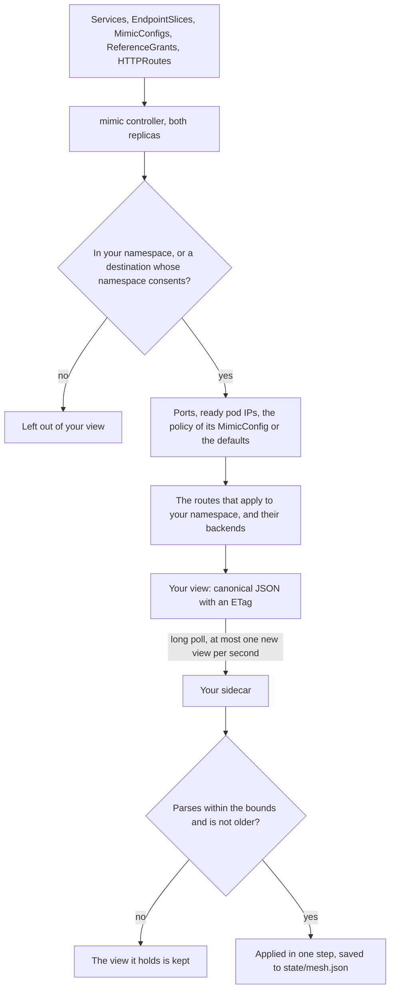
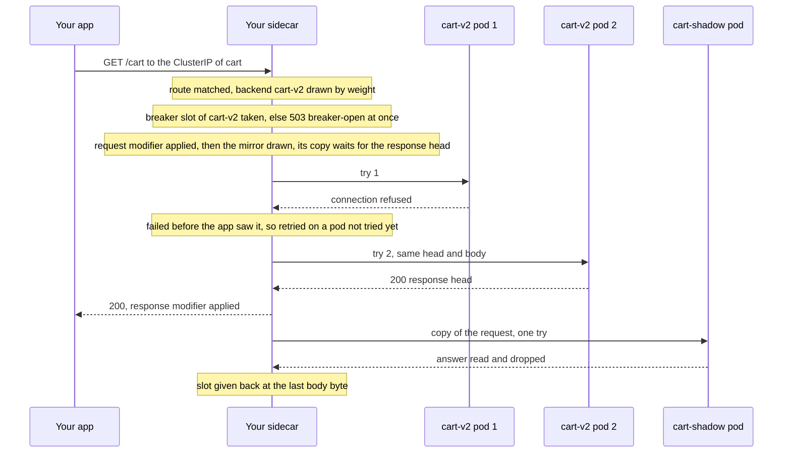

# Mesh

The **mimic mesh** makes the sidecar of a caller pick the pod that serves a call, instead of leaving
the choice to kube-proxy. Today (milestones M1 to M4) it does client-side **load balancing**, **retries** of failures
that happened before the app could process a request (with a retry budget), Gateway API **routes** (canary weights,
header modifiers, timeouts, mirrors), **outlier detection** and a **circuit breaker**; fault injection (M4, #452) and the rest
come in later milestones (see [What is coming](#what-is-coming)).
It works the same in modes `none` and `discovery` (see [Concepts](Concepts)); in `mock` the mock
answers and nothing is sent to a pod. It is on by default and has its own kill switches (below).

## What it does today

The controller builds, for each deployment, a **view**: the Services of its namespace (and the
declared destinations) with their ports and their ready pod IPs. Each sidecar follows its view by
long polling the controller, and keeps the last accepted one in `<MIMIC_TRUST_DIR>/state/mesh.json`.
A call from the app to the ClusterIP and port of a Service in the view is **in scope**; any other call
is **unscoped** and goes to its destination exactly as without the mesh.

For an in-scope call the sidecar waits up to 50 ms for the client's first bytes, then:

| First bytes of the connection | What the sidecar does |
|---|---|
| HTTP/1 request head (not `Upgrade`, not `CONNECT`) or the HTTP/2 preface (`h2c`) | **Per request**: each request goes to a pod, over a pooled connection to `<pod IP>:<target port>`. |
| TLS that mimic intercepts ([TLS interception](TLS-interception)) | Decrypted, balanced per request, then **re-originated over TLS** to the pod. SNI is the one the app sent (none: `<name>.<namespace>.svc`) and the pod's certificate is verified against that name, never the pod IP. Hostname verification cannot be turned off, and a pod is never spoken to in cleartext. A route that sends such a request to another Service still verifies against the name the app sent, so the other Service's pods fail verification and the call is answered `503` (fails closed): route intercepted-TLS traffic only to Services whose certificates also cover the parent's name. |
| Anything else client-first (binary protocols, TLS that is not intercepted) | **L4, per connection**: one pod is chosen, the bytes are relayed untouched. |
| Silence for 50 ms, a first request with `Upgrade` or `CONNECT`, an opaque port, mode `mock` | The plain byte relay to the original destination, as without the mesh. |

**Choosing a pod**: power of two choices, least request. Two distinct endpoints are drawn at random
and the one with the lower `(in_flight + 1) / weight` is taken; `in_flight` counts the requests of
this sidecar to that pod whose response is not complete (an L4 connection counts as one for its whole
life). **Slow start**: a pod that joins a Service port after the sidecar first saw it has weight
`max(0.1, min(1, age / window))`, the window being `policy.loadBalancer.slowStartSeconds` (default
30 s, 0 disables). A pod that leaves and comes back is new again.

**Pools** are per (pod IP, port, protocol, and server name for TLS): at most `maxConnections` HTTP/1
connections per pool (1024 unless a `MimicConfig` says otherwise,
[Circuit breaker](#circuit-breaker)) and 16 HTTP/2 connections per pod; idle ones close after `MIMIC_MESH_POOL_IDLE_TIMEOUT`; the pool of a
pod that leaves the view is dropped.

Discovery records one exchange per request under the authority the app sent (never the pod's address).
No header is added to a request or a response. A meshed sidecar does remove the `x-mimic-*` fields of its
**own app's** responses (see [Retries](#retries)).

## How it works, in two diagrams

**How the controller builds your view.** Both controller replicas watch the cluster and build, for each
deployment, the same view; your sidecar follows it by long polling and checks it before using it.



**One request through your sidecar.** A call to `cart` whose route sends 10 % of the requests to `cart-v2`
and mirrors them to `cart-shadow`, the first pod tried refusing the connection:



Without a route the request goes to the pods of `cart` itself, and the route, mirror and modifier steps do
not happen. A try is retried only when it failed before the app could process it, at most `1 + retries` tries
per request and within the retry budget: **`retries: 3` (the default) means up to 4 tries**. A pod whose
failures pile up is ejected from the choice for a while ([Outlier detection](#outlier-detection)). The rule's
timeouts, when it has some, bound the call and each try ([Timeouts](#timeouts)). The design pages behind
these diagrams are in
[`docs/design/mesh/`](https://github.com/Thaliph/mock-server/blob/main/docs/design/mesh/README.md).

## Scope

- Every Service of the **own namespace**.
- The Services listed in `spec.destinations` of the winning `MimicConfig` of the deployment (at most
  256 `{namespace, name}`). A destination in another namespace needs a `ReferenceGrant` in **that**
  namespace: `from: {group: mimic.platform.io, kind: MimicConfig, namespace: <yours>}`, `to: {group: "",
  kind: Service}` with `name` absent, empty or the Service's. Without it (or without the
  `ReferenceGrant` CRD) the destination is left out and the `MimicConfig` shows `ResolvedRefs: False`,
  reason `RefNotPermitted`. A namespace that did not consent contributes nothing to the view.
- **Opaque ports** keep the byte relay with no wait: `25, 587, 3306, 4444, 5432, 6379, 9300, 11211,
  22, 21` by default (server-first protocols or never HTTP). Replace the list with
  `MIMIC_MESH_OPAQUE_PORTS`.
- The view is bounded: 1024 Services, 10000 endpoints, 4Mi. A Service that does not fit is skipped
  (the Services of the namespace come first, in name order) and counted in
  `mimic_mesh_view_truncated_total`.

## Failure behaviour

| Situation | Result |
|---|---|
| Connecting to the chosen pod fails | The pod is **avoided** for 5 s and the request is tried again on a pod not tried yet, then on the **ClusterIP** (kube-proxy chooses; counted in `mimic_mesh_fallbacks_total`, access line `upstream` is the ClusterIP), at most `1 + retries` tries in all. See [Retries](#retries). |
| Every try failed to connect | `503` with `x-mimic-error: connect-failed` and `content-length: 0`, after 4 tries. L4: the connection is closed without a byte. |
| The Service port has no ready or serving-terminating endpoint | `503` with `x-mimic-error: no-endpoint`, empty body, answered at once. No ClusterIP fallback (kube-proxy would have no endpoint either). Not recorded by discovery; counted as `mimic_discovery_exchanges_total{result="synthetic"}` and `mimic_mesh_requests_total{reason="no-endpoint"}`. |
| All endpoints terminating (none ready) | The serving, terminating pods keep being used until the rollout ends. |
| **Controller down** | Nothing visible: the last view and mode are kept, and the long-poll retries after 1, 2, 4 … 30 s (jittered, never below 1 s). Balancing, pools and the avoidance of failing pods go on. Becomes a stale view after `MIMIC_MESH_STALE_AFTER`. |
| Intercepted TLS: the pod's certificate does not verify | A connect failure on that pod (same steps), then the ClusterIP verified the same way; the warn line `tls verification failed` has `upstream` and `tls_error`. |
| **Stale view** (no contact with the controller for `MIMIC_MESH_STALE_AFTER`) | Pod addresses are not used: new connections keep the byte relay and each request of an already routed connection goes to the ClusterIP (counted as a fallback). A dead controller never turns pod churn into errors. One WARN `mesh view stale` per streak; no pod IP older than the bound is used; back to the pods at the next applied view. |
| Rolling restart of the callee | Endpoints leave the view within about a second; the e2e `msh_87` saw 0 errors in 392 calls during a rollout and none after it ended (the baseline for the retries of M2). |
| A pooled connection the pod had closed before the request was written | Sent once more on a new connection to the same pod (`mimic_mesh_reconnects_total`), whatever the method; this is part of the same try, not a retry. When that new connection cannot be made either, the try is a connect failure and [Retries](#retries) goes on. A request that was written is only sent again as the table of [Retries](#retries) says. |

Kill switches: the chart value `mesh.enabled: false` (the cluster), `MimicConfig.spec.mesh.enabled:
false` (one workload). Then connections keep the byte relay; a connection already routed sends each
request to the ClusterIP.

## Configuration

**Helm** (`mesh.*`, chart `deploy/helm/mimic`):

| Value | Default | Env variable | Notes |
|---|---|---|---|
| `mesh.enabled` | `true` | `MIMIC_MESH` (`on`/`off`) | `false`: the controller serves no view (`404`), watches nothing and asks for no Service, EndpointSlice, Deployment, `MimicConfig` or `ReferenceGrant`; sidecars keep the plain relay. |
| `mesh.clusterName` | `local` | `MIMIC_CLUSTER_NAME` | Name of the cluster in the view. |
| `mesh.watchTimeout` | `30s` | `MIMIC_MESH_WATCH_TIMEOUT` | A held view request ends `304` after this; 100ms to 10m. |
| `mesh.debounce` | `100ms` | `MIMIC_MESH_DEBOUNCE` | Changes coalesced, doubled up to 1s while they keep arriving; 10ms to 1s. |
| `mesh.viewCacheBytes` | `64Mi` | `MIMIC_MESH_VIEW_CACHE_BYTES` | Cache of built views per replica; at least `maxViewBytes`, at most 4Gi. |
| `mesh.maxServices` | `1024` | `MIMIC_MESH_MAX_SERVICES` | 1 to 100000. |
| `mesh.maxEndpoints` | `10000` | `MIMIC_MESH_MAX_ENDPOINTS` | 1 to 1000000. |
| `mesh.maxViewBytes` | `4Mi` | `MIMIC_MESH_MAX_VIEW_BYTES` | 64Ki to 256Mi. |
| `mesh.maxWatches` | `10000` | `MIMIC_SIDECAR_API_MAX_WATCHES` | Held view requests per replica; over it `503` with `Retry-After`. |
| `mesh.staleAfter` | `60s` | `MIMIC_MESH_STALE_AFTER` | 1s to 1h. Handed to the injected sidecars. |
| `mesh.startupWait` | `2s` | `MIMIC_MESH_STARTUP_WAIT` | A sidecar without a view is ready after this long anyway; 0s to 1m. Handed to the sidecars. |

Sidecar-only variables (the webhook does not set them):

| Variable | Default | Meaning |
|---|---|---|
| `MIMIC_MESH_CONNECT_TIMEOUT` | `2s` | Time allowed to connect to a pod; 100ms to 10s. The original destination keeps the relay's 10 s. |
| `MIMIC_MESH_POOL_IDLE_TIMEOUT` | `90s` | Idle pooled connection to a pod is closed; 1s to 1h. |
| `MIMIC_MESH_RETRY_BUFFER` | `64Ki` | Request body bytes held per request so that it can be retried; `<n>`, `<n>Ki`, `<n>Mi`, 0 to 1Mi (`0`: a request with a body is retried only after a connect failure). |
| `MIMIC_MESH_RETRY_BUFFER_TOTAL` | `8Mi` | Request body bytes held for replay by all requests of the sidecar together; 1Mi to 64Mi. Sized for the 128 Mi sidecar limit: raising it needs a larger `MIMIC_INJECT_SIDECAR_RESOURCES` memory limit. |
| `MIMIC_MESH_OPAQUE_PORTS` | `25,587,3306,4444,5432,6379,9300,11211,22,21` | Comma-separated, at most 256 ports, or `none`. |
| `MIMIC_METRICS_MAX_ENDPOINTS` | `256` | Pods with a metrics label of their own; the rest are `other`; 1 to 10000. |

An invalid value exits the process with code 2 (see [Configuration](Configuration)). The avoidance
time of a failed pod (5 s), the number of retries (3) and the delay after a refusal (25 ms plus or minus 50 %)
are not configurable (no `MIMIC_*` variable sets them; the retries become a `MimicConfig` field with the retry
budget, #446).

**`MimicConfig`** (`mimic.platform.io/v1alpha1`, namespaced; see [Configuration](Configuration) for
the other CRDs) attaches to Deployments or Services of its own namespace with `spec.targetRefs`
(1 to 16):

```yaml
apiVersion: mimic.platform.io/v1alpha1
kind: MimicConfig
metadata: {name: cart, namespace: shop}
spec:
  targetRefs:
    - {group: apps, kind: Deployment, name: cart}
    - {group: "", kind: Service, name: cart}
  destinations:              # Deployment target: other Services this workload calls
    - {namespace: risk, name: scoring}
  mesh:
    enabled: true            # Deployment target: false = byte relay for this workload
  loadBalancer:
    slowStart: 30s           # Service target: <n>s, 0 to 3600 s, 0s disables
  outlierDetection:          # Service target: see [Outlier detection and circuit breaker](#outlier-detection-and-circuit-breaker)
    consecutiveFailures: 5
    baseEjectionTime: 30s
  circuitBreaker:
    maxRequests: 1024
```

Several configs for the same target: the oldest (`creationTimestamp`, then name) wins as a whole, the
others get `Accepted: False`, reason `Conflicted`. Other `Accepted: False` reasons: `TargetNotFound`,
`Invalid`. Without any `MimicConfig`: slow start 30 s, mesh on, no declared destinations.

## Retries

A mesh-routed request is tried again **only when its failure happened before the app could process it**.
A response of an app, any status (`5xx` included), is never retried. The classification is the pure
function `mesh::retry` of `mimic-core`.

| Failure of one try | Retried | `result` of the try, `reason` of the retry |
|---|---|---|
| Connect refused, connect timeout, failed TLS handshake or verification, a ninth TLS pool of a pod: nothing was written | every method | `connect_failed` |
| HTTP/2 `RST_STREAM` with `REFUSED_STREAM`, or a `GOAWAY` whose last-stream-id is 0 (no stream was processed; any other `GOAWAY` follows the next row) | every method | `refused_stream` |
| A **trusted refusal**: status `503`, exactly one `x-mimic-error` field, `overloaded` or `queue-timeout`, and exactly one `x-mimic-endpoint` field whose value parses as `<ipv4>:<port>` or `[<ipv6>]:<port>` and equals the pod address of this try | every method | `overloaded`, `queue_timeout` |
| A **trusted app refusal**: status `503`, exactly one `x-mimic-error: connect-failed`, exactly one `x-mimic-origin` (`inbound` or `inbound; pod=<name>`) and exactly one `x-mimic-endpoint` equal to the pod address of this try. The callee's sidecar writes it when its app refuses the connection (cleartext HTTP/1 and `h2c` only) | every method | `app_refused` |
| The connection closed or reset, or the stream reset with another code, after the request was written (in part) and before any byte of a response head | `GET`, `HEAD`, `OPTIONS`, `TRACE`, `PUT`, `DELETE` only (method tokens compared exactly) | `reset` |
| Any other response (a `503` that is not a trusted refusal, an `x-mimic-error` of another value, any other status), any failure after the response head | never | `ok` (a response head came back) |

**Bound per tier.** At most `1 + retries` tries per request, `retries` being 3 unless a `MimicConfig` says
otherwise: at most **4 tries** by default. A
reconnect of an unwritten request is part of its try. Each retry goes to a pod not tried yet, chosen as in
the load balancing (avoidance applies); when every endpoint was tried, to any of them. When every try so
far failed to connect and either no untried pod is left or the next try is the last one, that try goes to
the **original destination** (the ClusterIP) instead, at most once per request, and it ends the tries
(counted in `mimic_mesh_fallbacks_total`). A Service with one endpoint is tried on it, then on the
ClusterIP; a request never reaches more than 4 destinations. A try on the original destination (fallback,
stale view, a view that turned `"mesh": false`) is never retried. On an L4 connection only connect failures
are retried (at most 4 connects; with every try failed the connection is closed without a byte): once a
byte was sent to a pod, a close or reset is relayed.

**Retry budget.** Retries are also bounded over time, so that a failing Service is not hit by more retries
than requests. Each caller pod (its sidecar) keeps one budget per backend Service, shared by all the ports of
the Service. Over the last `window` (default 10 s) it counts the requests (every first try of a mesh-routed
request, every mesh-balanced L4 connection) and the retries it granted. A retry is granted when

```
retries in the window + 1  <=  percent / 100 * requests in the window  +  minPerSecond * window seconds
```

With the defaults (`percent` 20, `minPerSecond` 10, `window` 10 s) the second term is 100 retries plus 20 % of
the requests of the window: a pod that sent 500 requests in the last 10 s may retry up to 200 of them
(100 + 0.2 x 500), a nearly idle one up to 100. A retry over budget is **not made**: the failure is returned
as the "when no try is left" rules below say, `mimic_mesh_retry_budget_exhausted_total{backend}` counts it and
the sidecar logs a warning `retry budget exhausted` (at most once per second per backend). The window slides in
tenths, so a count stays between 0.9 and 1 window. `retries: 0` gives one try per request, with no retry and
no fallback to the ClusterIP. Both settings are per Service, in a `MimicConfig` targeting it (each field
that is absent keeps its default):

```yaml
apiVersion: mimic.platform.io/v1alpha1
kind: MimicConfig
metadata: {name: cart, namespace: shop}
spec:
  targetRefs: [{group: "", kind: Service, name: cart}]
  retries: 2                # 0 to 10, default 3
  retryBudget:
    percent: 10             # 0 to 100, default 20
    minPerSecond: 5         # 0 to 1000, default 10
    window: 10s             # 1s to 60s, default 10s
```

A change reaches the callers with the next view (within the sidecar's pull interval); a changed `window`
starts the Service's budget empty.

**Delays.** Connect failures, refused streams, app refusals and resets are retried at once; a trusted refusal after a
delay drawn between 12.5 and 37.5 ms. The body of a refused try is read and discarded up to 64 KiB (at most
2 s) before the delay.

**The binding.** A refusal is trusted only on a **cleartext pod try** whose `x-mimic-endpoint` **names that
pod**:

- A try on the original destination has no pod address: none of its answers is trusted.
- **Never over TLS.** On a try over intercepted TLS no answer is a trusted refusal: the callee's sidecar
  cannot remove `x-mimic-*` from what it does not decrypt, so the fields cannot be bound to it. A `503`
  with them is an answer of the app, passed as received and never retried; connect failures (a failed
  verification included) are retried as on cleartext.
- An answer naming another pod, the ClusterIP, or carrying two `x-mimic-error` or two `x-mimic-endpoint`
  fields is passed as received and not retried.
- A trusted refusal is judged on the complete final response head only.

The refusal is the signal of the callee's own sidecar, which writes the `<pod ip>:<port>` it was reached on.
No sidecar generates one before M5, so in M2 only a peer outside the mesh sets it. A meshed inbound sidecar
removes every `x-mimic-*` field of its app's responses, and the binding covers peers that do not: an app that
forwards a downstream refusal names the downstream pod, never the one its caller sent the try to. A refusal
therefore never makes the callers of a forwarding app retry: each tier retries only its own tries, so the
total is at most 4 tries per tier.

**Inbound stripping.** With `MIMIC_MESH=on`, unless the view says `"mesh": false` (this also holds before the
first view), the inbound side removes every field whose name starts with `x-mimic-` (any case) from the final
response heads of its app, so that only a sidecar ever writes them. HTTP/1: the relay holds each final head
until it is whole (at most 64 KiB; `1xx` heads are not held) and writes it without those lines, every other
byte unchanged; the body and the framing are untouched. HTTP/2: the fields are removed from the response
headers; trailers are not touched. Each field removed counts in `mimic_mesh_stripped_headers_total`. With
`MIMIC_MESH=off` or a view of `"mesh": false` the relay is byte-exact. While the fields are removed, a
response the sidecar cannot frame (a bare CR, a header line without a colon or with a name that is not a
token, a head over 64 KiB, an invalid body framing) is not relayed: **both sockets are closed**, so no
later response of the connection can carry a field that was not removed. The caller sees a close or reset,
which its sidecar takes as an app failure, never as a refusal. It is counted in
`mimic_mesh_unframed_closes_total` and logged once per connection at `warn`, without any byte of the app.
Inbound TLS is relayed unchanged.

**Request bodies and the replay buffer.** A request is retried only while every byte of its body read from
the app is still held for replay: at most `MIMIC_MESH_RETRY_BUFFER` (64 KiB) per request and
`MIMIC_MESH_RETRY_BUFFER_TOTAL` (8 MiB) for all the requests of the sidecar together
(`mimic_mesh_retry_buffer_bytes`). A request whose body grows past its share, or that finds the total in
use, is streamed: it is still retried after a connect failure (nothing of it was written), never once a byte
of it was written (`mimic_mesh_retries_skipped_total{reason="buffer"}`). The bytes held are released when a
try gets its response head or the request can no longer be retried. A retry sends the same head and the same
body bytes.

**When no try is left**: connect failures give `503` `x-mimic-error: connect-failed`; a trusted refusal is
passed to the app **as received**, its `x-mimic-error` and `x-mimic-endpoint` fields included; a reset is
propagated as in M1 (HTTP/1: the app's connection closed without an answer; HTTP/2: the app's stream
reset); a refused stream resets the app's stream with `REFUSED_STREAM`.

**Never retried**: requests answered by the mock (mode `mock`), the `no-endpoint` answer, an `Upgrade` or
`CONNECT` once its head was written (its connect is retried like any), an L4 connection once a byte was
sent, and anything on the byte relay.

One access line is written per request, with `upstream` the address of the last try and `attempts` the number
of tries. Discovery records the final exchange once; a trusted refusal passed to the app is not recorded
(`mimic_discovery_exchanges_total{result="synthetic"}`).

## Outlier detection and circuit breaker

Two guards against a failing pod and an overloaded Service, both **per caller pod** (each sidecar keeps its
own state, learns from its own requests and shares nothing) and both set by a `MimicConfig` on the **Service**:

```yaml
apiVersion: mimic.platform.io/v1alpha1
kind: MimicConfig
metadata: {name: cart, namespace: shop}
spec:
  targetRefs: [{group: "", kind: Service, name: cart}]
  outlierDetection:
    consecutiveFailures: 5   # 1 to 100; connect failures, resets and the like, in a row
    consecutive5xx: 0        # 0 to 100; 0 = off (the default)
    baseEjectionTime: 30s    # 1s to 300s
    maxEjectionPercent: 50   # 0 to 100; 0 = never eject
  circuitBreaker:
    maxRequests: 1024        # 1 to 100000 requests in flight per caller pod
    maxConnections: 1024     # 1 to 100000 HTTP/1 connections per pool
```

Each field left out takes its default (shown); the other fields of the object are not affected. Without any
`MimicConfig` the defaults apply to every Service of the mesh.

### Outlier detection

A pod whose **proxy-level failures** pile up is **ejected**: it is left out of every choice of the caller's
sidecar (first tries, retries, mirror copies, L4 connections) for an ejection time, then it is a candidate
again.

- **What counts as a failure** (`consecutiveFailures`): a connect that failed (refused, timed out, TLS
  handshake or verification failed), a trusted refusal of the app (`app_refused`, [Retries](#retries)), a
  connection closed or reset after the request was written and before any byte of the response head (any
  method, retried or not), and a response head the sidecar cannot parse. **Any response head of the pod resets
  the count.**
- **What is neutral** (the count stays as it is): the refusals of the pod's admission (`overloaded`,
  `queue-timeout`) and refused HTTP/2 streams (a busy pod is not a broken one, and ejecting it would move its
  load onto its siblings), a route timeout (the author's bound), the app leaving before the head, anything after
  the response head, and tries to the ClusterIP.
- **`consecutive5xx`** counts the `5xx` heads a pod answers, those that are not a trusted refusal. **It is off
  by default (`0`)**: a `5xx` is the app's answer, often caused further down the call chain, and ejecting on it
  can spread an outage (every pod of a Service whose database is down answers `500`). Turn it on for a Service
  whose own pods fail alone; `maxEjectionPercent` still bounds the damage.
- **`maxEjectionPercent`**: at most `⌊n × percent / 100⌋` of the `n` endpoints of a Service port are ejected
  at once, **rounded down, with no minimum of one**. At the default 50 %, 1 pod is **never** ejected, 2 or 3 pods
  eject at most 1, 4 pods at most 2. `100` can eject all of them; `0` turns ejection off. The bound holds at every
  instant: a view that shrinks the port or lowers the percentage restores the ejections that end first.
- **Ejection time**: `baseEjectionTime × 2^k`, at most **300 s**, `k` being the earlier ejections of the pod
  in its streak: 30 s, 60 s, 120 s, 240 s, 300 s, 300 s ... at the default. The streak ends once the pod has
  been restored for 300 s without a new ejection. There is no probe: a restored pod simply competes again, and
  the least-request choice gives it only its share.
- **With avoidance.** The 5 s avoidance of a pod after a failed connect ([Failure behaviour](#failure-behaviour))
  stays: it is the soft, immediate exclusion, ejection is the hard one on top. A blackholed pod costs one
  connect timeout, not five.
- **When every endpoint is ejected** (only with `maxEjectionPercent: 100`), a request is answered `503`
  `breaker-open` without any try, an L4 connection is closed, a mirror copy is an `error`.

### Circuit breaker

`maxRequests` bounds the mesh-routed requests of **one caller pod** in flight to **one backend Service** (all its
ports together). A request takes a slot from its first try until its response is complete (or it ends); its
retries, reconnects and the fallback are inside that one slot. A request that finds no free slot is answered
at once by the caller's sidecar: `503`, `x-mimic-error: breaker-open`, an empty body, no `x-mimic-endpoint`
(it names no pod, so no sidecar trusts it). Nothing is sent to a pod or to the ClusterIP, the request is not
retried and asks nothing of the retry budget.

- **Held streams** (SSE, gRPC streams) keep their slot for their whole life; an `Upgrade` or `CONNECT` gives
  it back when the answer head arrives. Size `maxRequests` above the number of streams a caller keeps open.
- **Outside the breaker**: mirror copies (they have their own bounds, [Mirroring](#mirroring)), L4-balanced
  connections (the app's own connections bound them), requests the mock answers, requests of a stale view.
- `maxConnections` bounds the HTTP/1 connections of one pool (pod, port, protocol); a request over it waits for
  a free connection, inside its slot and its timeouts. HTTP/2 keeps 16 connections per pod.
- **Per caller pod**: a Service called by 10 pods with `maxRequests: 100` can see 1000 requests. Whoever may write
  a `MimicConfig` for the Service can throttle all its callers (`maxRequests: 1`): it is the RBAC of the Service's
  namespace, as for the retries.

Logs: INFO `endpoint ejected` (`service`, `backend`, `endpoint`, `reason`, `ejection_seconds`, `ejections`) and
`endpoint restored` (`cause`: `elapsed` or `max_percent`), one line each, written at most 1 s late; WARN
`breaker open` at most once per second per Service (`cause`, `in_flight`, `max_requests`, `suppressed`).
Metrics: `mimic_mesh_ejections_total` and `mimic_mesh_ejected_endpoints` ([Observability](#observability)); a
`breaker-open` answer is counted in `mimic_mesh_requests_total{reason="breaker-open"}` and its access line has
`reason`. See [Troubleshooting](Troubleshooting#mesh).

## Routes

With the Gateway API CRDs installed ([Install](Install#gateway-api-optional)), the controller reads every
`HTTPRoute` (`gateway.networking.k8s.io/v1`) whose `parentRefs` name a **Service** (`group: ""`, `kind: Service`;
the GAMMA convention), compiles it and puts it in the views of the callers it applies to. Routes with Gateway
parents are ignored. **The sidecar applies the matches, the backend weights and the header modifiers of a
route**, timeouts included ([Timeouts](#timeouts)) and mirrors ([Mirroring](#mirroring)).

**Supported**, per rule: `matches` with `path` (`Exact`, `PathPrefix`), `headers` and `queryParams` of type
`Exact`, `method`; `backendRefs` to Services with `port` and `weight`; the filters `RequestHeaderModifier`,
`ResponseHeaderModifier` and `RequestMirror`; `timeouts.request` and `timeouts.backendRequest`; `name`. `retry`
is ignored (retries are set by `MimicConfig`, [Retries](#retries)); `hostnames` is ignored.

**Refused**: a route is not programmed, and is in no view, when it has a `RegularExpression` match, a filter
`URLRewrite`, `RequestRedirect`, `CORS` or `ExtensionRef`, `backendRefs[].filters`, a field the controller does
not know (experimental channel), a modifier naming `host`, `Content-Length`, `Transfer-Encoding`,
`Connection`, `Keep-Alive`, `Proxy-Connection`, `TE`, `Trailer`, `Upgrade` or any `x-mimic-*` field, or a
`spec` over 64 KiB. Its status says which.

### Canary walkthrough

Two Deployments `cart-v1` and `cart-v2`, each with its own Service, and the Service `cart` that callers use. Send
10% of the requests to `cart-v2`:

```yaml
apiVersion: gateway.networking.k8s.io/v1
kind: HTTPRoute
metadata: {name: cart-canary, namespace: shop}
spec:
  parentRefs: [{group: "", kind: Service, name: cart, port: 80}]
  rules:
    - backendRefs:
        - {name: cart-v1, port: 80, weight: 90}
        - {name: cart-v2, port: 80, weight: 10}
```

1. `kubectl -n shop get httproute cart-canary -o yaml`: `Accepted` and `ResolvedRefs` are `True` in the
   `status.parents[]` entry of `mimic.platform.io/mesh`. The sidecars of the callers pick the route up with
   their next view (long poll, seconds).
2. Read the split in the caller's sidecar: `mimic_mesh_requests_total{service="shop/cart",route="shop/cart-canary",backend="shop/cart-v1:80"}`
   against the same series with `backend="shop/cart-v2:80"`; the ratio of their rates is the weights, within the
   noise of a draw per request. An access line of the caller ([Access logs](Access-logs)) has `route`, `rule` and
   the drawn `backend`.
3. Send the requests that carry `x-canary: 1` to `cart-v2` only, by putting a header match first:

   ```yaml
   rules:
     - matches: [{headers: [{type: Exact, name: x-canary, value: "1"}]}]
       backendRefs: [{name: cart-v2, port: 80}]
     - backendRefs:
         - {name: cart-v1, port: 80, weight: 90}
         - {name: cart-v2, port: 80, weight: 10}
   ```

4. Shift everything to the new version by changing the weights to `0` and `100` (a weight `0` backend is never
   drawn): `kubectl -n shop patch httproute cart-canary --type=json -p '[{"op":"replace","path":"/spec/rules/0/backendRefs/0/weight","value":0},{"op":"replace","path":"/spec/rules/0/backendRefs/1/weight","value":100}]'`.
   The change reaches every caller with one view update; from then on `cart-v1` has no new request.
5. Delete the route to go back to the Service's own pods.

**What a route does in the sidecar.** For a Service port that has routes (`ports` of the route), each request of a
meshed caller is matched against every match of every rule of the port's routes, over the request as the app sent
it: the path as received (byte for byte, no decoding, no normalisation), the method, the headers and the query
parameters; the host is never compared (`hostnames` is ignored). The winner is the Gateway API's precedence: an
`Exact` path before a prefix, then the longest prefix, then a `method`, then the most header matches, then the most
query matches, then the oldest route, then the first rule written. The backend is drawn by weight, once per
request, and the request goes to a pod of that backend with **that backend's** retry policy and budget: retries
and the fallback never leave the backend. `RequestHeaderModifier` is applied once, before the first try, and
`ResponseHeaderModifier` to the final response head from the pod. Upgrade and `CONNECT` requests and L4
connections are not routed, a stale view or mode `mock` routes nothing.

**When nothing matches.** A port that has routes answers a request that no rule matches `404` with
`x-mimic-error: no-route` (nothing is sent to a pod; the answer is not recorded by discovery). This is the
default, as in Istio and Linkerd. A rule that matches everything and names the Service itself gives the old
behaviour back:

```yaml
rules:
  - matches: [{path: {type: PathPrefix, value: /cart}}]
    backendRefs: [{name: cart-v2, port: 80}]
  - backendRefs: [{name: cart, port: 80}]   # catch-all: the rest goes to cart's own pods
```

A rule whose weights are all `0` (or with no backend) answers `500` `no-backend`; a drawn backend that is
invalid (a Service that is not in the view, a missing `ReferenceGrant`, a missing port) answers `500`
`invalid-backend` for its share of the requests. See [Troubleshooting](Troubleshooting#mesh).

**Producer and consumer routes.** A route in the namespace of its Service is a *producer* route: every caller
that has the Service in its view gets it. A route in another namespace than the Service is a *consumer* route
and applies to the callers of **its own namespace only**; for them it replaces the producer routes of that
Service. A route of a third namespace applies to nobody else.

**Backends in another namespace** need a `ReferenceGrant` in the backend's namespace, `from` `HTTPRoute`:

```yaml
apiVersion: gateway.networking.k8s.io/v1beta1
kind: ReferenceGrant
metadata: {name: allow-routes, namespace: backends}
spec:
  from: [{group: gateway.networking.k8s.io, kind: HTTPRoute, namespace: shop}]
  to: [{group: "", kind: Service}]
```

A grant for `MimicConfig` does not allow a route, and the other way round. Without the grant, or after it is
deleted, the backend is not in the view and the route's `ResolvedRefs` is `False`, reason `RefNotPermitted`.

**Reading the status.** For each Service parent that exists the controller writes one entry in
`status.parents[]` with `controllerName: mimic.platform.io/mesh` and two conditions:

```bash
kubectl -n shop get httproute cart-canary -o jsonpath='{range .status.parents[?(@.controllerName=="mimic.platform.io/mesh")].conditions[*]}{.type}={.status} {.reason} {.message}{"\n"}{end}'
```

| Condition | Reason | Meaning |
|---|---|---|
| `Accepted` `True` | `Accepted` | Programmed. The message says `retry is configured by MimicConfig` when the route has `retry`. |
| `Accepted` `False` | `UnsupportedValue` | Refused; the message is `unsupported: <field path>`, the first such field (`rules[0].filters[0].type`). |
| `Accepted` `False` | `NoMatchingParent` | The entry's `port` is not a port of the Service, or it has a `sectionName`. |
| `ResolvedRefs` `False` | `RefNotPermitted`, `InvalidKind`, `BackendNotFound` | A backend or mirror lacks a `ReferenceGrant`, is not a core Service, or does not exist (or lacks the port). The route stays programmed; that backend's share of the requests is answered `500` `invalid-backend`. |

Entries of other controllers in the same list are never changed. The status of a route whose Service parent
does not exist stays empty, and entries mimic wrote stay after `helm uninstall`.

> **Warning: route values reach other pods.** Header and query values of a route are copied as written into
> the views of every pod it applies to (producer routes: every namespace that has the Service in its view) and
> into their state files. An `HTTPRoute` is configuration, not a Secret: **do not put a credential in a
> `RequestHeaderModifier`.** See [Security](Security#mesh).

Older Gateway API CRDs than 1.2 make the API server prune `timeouts` before mimic reads a route; with the
experimental channel a route with a field mimic does not know is `UnsupportedValue`, never half-applied.

### Timeouts

A rule's `timeouts` bound the requests it routes (Gateway API `HTTPRouteTimeouts`, CRDs 1.2 or later):

```yaml
rules:
  - backendRefs: [{name: slow, port: 80}]
    timeouts:
      request: 3s          # the whole call
      backendRequest: 1s   # one try
```

- `request` bounds the **whole call**: it starts when the sidecar has the request head and covers every try, the
  connects, the pool waits, the pauses between tries, the fallback to the original destination and the response
  body up to its last byte.
- `backendRequest` bounds **one try**: it starts when the try's request is handed to its connection (connect and
  pool wait keep `MIMIC_MESH_CONNECT_TIMEOUT`) and runs to the last byte of that try's response. Each try has its
  own, and none outlives what is left of `request`.
- **Before the response head**, the sidecar answers `504` with `x-mimic-error: timeout`. **After the head**, the
  response cannot be changed: an HTTP/1 connection to the app is closed and an HTTP/2 stream is reset with
  `INTERNAL_ERROR`, so the app sees a cut response.
- **A timeout is never retried** and asks nothing of the retry budget ([Retries](#retries)). The pod is not
  avoided either.
- `0s` turns a timeout off, same as leaving it out. **There is no default timeout**: a request that no rule
  routes (no route, a stale view, mode `mock`, `Upgrade`, `CONNECT`, L4) has none.
- Nothing in the request sets or extends a timeout: `grpc-timeout`, `x-envoy-upstream-rq-timeout-ms` and
  `x-mimic-*` fields are never read.
- The expiry is in the access line (`result: timeout` and `timeout`, [Access logs](Access-logs)) and in
  `mimic_mesh_attempts_total{result="timeout"}` and `mimic_mesh_requests_total{reason="timeout"}`
  ([Monitoring](Monitoring)).

A route of the callee's namespace sets the timeouts of every caller that has no route of its own; a route of the
caller's namespace overrides it ([Limits](#limits)).

### Mirroring

A `RequestMirror` filter sends a **copy** of the requests a rule routes to a second Service, to try a new
version on real traffic without answering from it:

```yaml
rules:
  - backendRefs: [{name: cart, port: 80}]
    filters:
      - type: RequestMirror
        requestMirror:
          backendRef: {name: cart-shadow, port: 80}
          percent: 10        # 10 % of the requests; leave it out for all of them
```

`percent` (or `fraction`, a numerator over a denominator) is drawn per request and per mirror; a rule has at most
16 mirrors. The mirror Service may be in another namespace if that namespace has a `ReferenceGrant` for it
(see *Backends in another namespace* above); without one the mirror is left out and the route shows
`ResolvedRefs: False`, `RefNotPermitted`.

**What is copied.** The method, the target and the `Host` as the app sent them, the fields of the request **as
the primary backend gets them**, that is after the rule's `RequestHeaderModifier`, and the body with its
trailers. A mirror written **before** the modifier in `filters` gets the fields as the app sent them, while the
backend still gets the modified ones (Gateway API applies filters in order). Nothing is added to the copy, no
marker field: the mirror sees a request like the backend's. The copy goes to one pod of the mirror Service,
chosen like any other (least loaded of two), in the protocol the app spoke (HTTP/1 or HTTP/2, over intercepted
TLS verified against the name the app sent), on connections of its own, so a slow mirror never takes a
connection of the primary.

**The response is discarded.** It is read and dropped, never relayed, recorded or trusted: a mirror answering
`500` or a forged `x-mimic-error` changes nothing for the app. The app's answer, timing, retries and timeouts are
those it would have without the mirror. A copy is **never retried**, never falls back to the ClusterIP, asks
nothing of the retry budget and is **not routed again**: the mirror Service's own routes are not looked at, so a
mirror is never mirrored.

**Bodies.** A copy carries the whole body or is not sent. A request without a body is copied at once; otherwise
the body is held in the same buffer as for retries, at most `MIMIC_MESH_RETRY_BUFFER` (64 KiB) per request and
`MIMIC_MESH_RETRY_BUFFER_TOTAL` (8 MiB) for the sidecar, mirrors and retries together, one charge per request
however many copies and tries share it. The copy starts once the end of the body was read from the app, so a
mirror pod gets a large upload after the primary began. With `MIMIC_MESH_RETRY_BUFFER=0` only requests without
a body are mirrored.

**Best effort.** A copy is skipped when its body is larger than its share, when the total buffer is in use, when
the body has not ended at the copy's deadline (a long gRPC or HTTP/2 stream is never mirrored), or when
**256 copies per mirror Service port** or **1024 per sidecar** are already in flight. Each copy ends at the
earliest of **10 s** and the rule's `timeouts.request` and `timeouts.backendRequest` (non-zero ones), counted
from the request head. A copy waits for its body while holding its slot, up to that deadline, so slow uploads can fill
the 256 slots of a port (the next copies are then counted `skipped_limit`). Copies in flight at the end of the `SIGTERM` grace are dropped, and none starts after it.
Each drawn mirror is counted once in `mimic_mesh_mirrored_total{backend,result}`
([Monitoring](Monitoring#mesh-metrics)); the access line of the request has `mirrored: true` when a copy was
sent or failed ([Access logs](Access-logs)). Copies write no log line of their own and discovery never
records them.

**Not mirrored**: a request that no rule matched, an answer `no-route`, `no-backend` or `invalid-backend`, a
stale view, mode `mock`, an `Upgrade` or `CONNECT`, L4 connections.

> **Warning: copies carry the caller's credentials.** A copy is the request the backend sees: its
> `Authorization` and `Cookie` fields, tokens in the query and the body go **unredacted** to the pods of the
> mirror Service, and the mirror's app may log what it receives. Mirror only to a Service you would trust with
> the real traffic. Who can cause it: the author of a route in the **callee's** namespace owns the parent Service
> and already receives these requests; the author of a route in a **caller's** namespace mirrors only that
> namespace's calls; a mirror in another namespace needs that namespace's `ReferenceGrant`, which is its consent
> to receive. Copies leave from the caller's pod, so its NetworkPolicy applies to them.

**Loops.** A mirror app that calls back (A's route mirrors to B, whose app calls A's Service) makes new requests
that are routed and mirrored like any other: without trace context mimic cannot tell them apart. Each hop is
bounded by its mirrors (16), the slots and the 10 s deadline, but breaking the loop is up to the route authors: use
a `percent`, or no mirror to a Service that calls back.

## Observability

Sidecar metrics (only with `MIMIC_MESH=on`; `service` is `<namespace>/<name>`, `backend` is
`<namespace>/<name>:<port>`):

| Metric | Labels |
|---|---|
| `mimic_mesh_requests_total` (per mesh-routed request) | `service`, `route` (`<namespace>/<name>` of the matched route, `none` when no route matched; at most 256 distinct values, then `other`), `backend`, `status_class` (`1xx` to `5xx`, `none`), `reason` (`none`, the `x-mimic-error` of an answer of the sidecar, including `no-route`, `no-backend` and `invalid-backend`, `breaker-open`, or that of a trusted refusal passed to the app) |
| `mimic_mesh_request_duration_seconds` (until the response head) | `service`, `backend`, `status_class` |
| `mimic_mesh_endpoint_requests_total` | `backend`, `endpoint` (`ip:port` or `other`), `status_class` |
| `mimic_mesh_endpoint_in_flight` | `backend`, `endpoint` |
| `mimic_mesh_reconnects_total`, `mimic_mesh_fallbacks_total` | `backend` |
| `mimic_mesh_attempts_total` (every try, to a pod or to the original destination; a reconnect is not a try) | `backend`, `result` (`ok`, `connect_failed`, `refused_stream`, `reset`, `app_refused`, `overloaded`, `queue_timeout`, `timeout`) |
| `mimic_mesh_retries_total` (tries after the first) | `backend`, `reason` (`connect_failed`, `refused_stream`, `reset`, `app_refused`, `overloaded`, `queue_timeout`) |
| `mimic_mesh_retries_skipped_total` (a retried kind of failure that was not retried) | `backend`, `reason` (`exhausted`: no try left; `method`: a `reset` of a method that is not idempotent; `buffer`: the body was not held) |
| `mimic_mesh_retry_buffer_bytes` (gauge, at most `MIMIC_MESH_RETRY_BUFFER_TOTAL`) | none |
| `mimic_mesh_mirrored_total` (one per drawn mirror of a routed request, [Mirroring](#mirroring)) | `backend` (the mirror Service port), `result` (`sent`, `error`, `skipped_body`, `skipped_limit`) |
| `mimic_mesh_stripped_headers_total`, `mimic_mesh_unframed_closes_total`, `mimic_mesh_inbound_refusals_total` (one per inbound connection answered `503` `connect-failed` because the app refused it) | none |
| `mimic_mesh_unscoped_connections_total` | none |
| `mimic_mesh_ejections_total` (one per ejection, [Outlier detection](#outlier-detection)) | `backend`, `reason` (`consecutive_failures`, `consecutive_5xx`) |
| `mimic_mesh_ejected_endpoints` (gauge, ejected now) | `backend` |
| `mimic_mesh_view_pulls_total` | `result` (`ok`, `not_modified`, `older`, `invalid`, `error`) |
| `mimic_mesh_view_age_seconds`, `mimic_mesh_view_services`, `mimic_mesh_view_endpoints` | none |

Series of a pod that left the view are removed 5 minutes later. No label carries a path, header or
other caller-controlled string.

Controller metrics: `mimic_mesh_objects` (`kind`, with `httproute`), `mimic_mesh_gateway_api_present`, `mimic_mesh_routes` (`state`), `mimic_mesh_route_status_total` (`result`), `mimic_mesh_view_builds_total` (`result`),
`mimic_mesh_view_build_duration_seconds`, `mimic_mesh_watches`, `mimic_mesh_view_truncated_total`,
`mimic_mesh_view_cache_bytes`. See [Monitoring](Monitoring).

`mimic_mesh_requests_total` and the duration stay one per request (the duration spans every try);
`mimic_mesh_endpoint_requests_total` counts each try written to the pod. Access lines of mesh-routed
requests and L4-balanced connections gain `backend`, `upstream` (the pod `ip:port` of the last try; the
ClusterIP after a fallback) and `attempts` (the number of tries, 1 without a retry; for L4 the number of
connects tried). `dst` stays the original destination. Lines of relayed
connections have neither.

Warnings to know: `breaker open`, `mesh view stale` (once per stale period), `mesh view rejected` (a view that does not
parse, once per streak), `tls verification failed`.

## Limits

- Mesh-routed HTTP/1 goes through `hyper`, so it is not byte-exact: header order across different
  names is not kept (case and the order of fields of one name are), chunk extensions are dropped,
  `Connection`, `Keep-Alive`, `Proxy-Connection` and `TE` are consumed per hop, pipelined requests are
  serialised, a response with neither length nor `chunked` reaches the app `chunked`.
- A request head the sidecar cannot frame (bad tokens, bare `CR`, `obs-fold`, conflicting
  `Content-Length`, a `Transfer-Encoding` not ending in `chunked`, over 64 KiB or 256 lines) is
  answered `400` `x-mimic-error: invalid-request` and the connection closes; the byte relay would have
  forwarded it.
- The **first request** of a connection with `Upgrade` or `CONNECT` keeps the byte relay for the whole
  connection. A later one leaves `hyper`: a pod is chosen, the head is written as received and the
  connection becomes a byte relay to that pod. An HTTP/2 `CONNECT` is answered `501` `unsupported`.
- A client silent for 50 ms after connecting, or whose first request head is not whole within the first
  16 KiB, stays on the byte relay for the life of that connection: per-request balancing holds for
  clients that send at once.
- Intercepted TLS: the app is answered `http/1.1` when it offered it, else `h2`, and the pod is offered
  only that protocol. A pod that **requests a client certificate** fails the handshake (`503`): exclude
  that destination in [TLS interception](TLS-interception).
- Answers of the sidecar itself (`503 no-endpoint`, `503 connect-failed`, `502 invalid-response`,
  `400`, `501`) are not recorded by discovery.
- Balancing is per caller sidecar: each one counts only its own in-flight requests.
- **A pod can make its callers retry requests sent to itself.** An app whose own sidecar does not remove
  `x-mimic-*` (no sidecar, mesh switched off, inbound TLS) can answer a forged `503` refusal bound to its own
  address: its callers' sidecars then send that request to its sibling pods, at most 3 more times, and only
  requests that were sent to that pod. It cannot make a caller retry a request sent to another pod, nor make
  the callers of a pod that forwards its answers retry.
- **Idempotent by method name.** A `GET`, `HEAD`, `OPTIONS`, `TRACE`, `PUT` or `DELETE` that a pod read and
  then dropped without an answer is sent to another pod: an app whose such methods have side effects can see
  one request twice. The retry budget bounds this per caller pod and Service: a reset that every tier
  propagates as a reset costs at most a factor `(1 + percent / 100)` per tier, plus the floors
  (`minPerSecond` per caller pod); refusals and connect failures never reach an app twice, at any depth.
- **An injected callee whose app refuses connections over TLS looks like a reset.** On cleartext HTTP/1 and
  `h2c` its meshed sidecar answers `503` `x-mimic-error: connect-failed` with `x-mimic-endpoint` (its pod
  address) and `x-mimic-origin: inbound; pod=<name>`, and every method is retried on another pod. Over inbound
  TLS, which it does not decrypt, it closes the connection without a byte: only the idempotent methods
  above are retried, a `POST` gets the close. With the mesh off nothing is answered.
- **No timeout without a route.** A request that no rule with `timeouts` routes waits as long as the app's own
  connection does; mimic sets no default ([Timeouts](#timeouts)).
- **A route timeout counts the app's own pace.** `request` and `backendRequest` run until the last byte of the
  response is handed to the app: an app that reads a large response slowly, or sends its request body slowly,
  can time its own call out.
- **A cut close-delimited response can look complete.** After the head a timeout closes the app's HTTP/1
  connection; an HTTP/1.0 response with neither `content-length` nor chunked framing ends at the close, so the
  app cannot tell it was cut. HTTP/1.1 and HTTP/2 apps always see the cut.
- **A producer route's timeouts bind every caller.** A route of the callee's namespace sets the timeouts of every
  caller without a route of its own, as it sets their weights: `request: 1ms` makes every such call answer `504`.
  A route of the caller's namespace overrides it.
- **A timed-out request may have been processed.** A `504` says no complete response came back in time, not that
  the pod did nothing. This is why a timeout is never retried.
- **Inbound heads are held when the mesh is on.** The inbound HTTP/1 relay writes a final response head once
  it is whole (at most 64 KiB) instead of as it is read: timing only, no byte changes but the `x-mimic-*`
  lines.
- **A response that cannot be framed closes the inbound connection when the mesh is on** (see
  [Retries](#retries)). Such an app works with the mesh off or a view of `"mesh": false`. A request that
  cannot be framed (client side) is still relayed unchanged, and so is what the app answers to it.
- **Mirrors are best effort and carry credentials.** Copies are skipped when their body does not fit the replay
  buffer, the slots are full or the body has not ended in time; they are not a delivery guarantee, and they go
  unredacted to the mirror's pods ([Mirroring](#mirroring)).
- Outlier state is per caller pod: a pod ejected by one caller is still tried by the others until they see its failures
  themselves; the breaker is per caller pod too ([Outlier detection and circuit breaker](#outlier-detection-and-circuit-breaker)).
  Failures forged by an app eject only its own pod. A peer or a spoofed reset can eject an address for one ejection
  time: there is no identity check without mTLS.
- Not yet: active health checks, admission control.

## What is coming

- **M2**: retries of proxy-level failures on another pod, the retry budget and `MimicConfig.retries` are in
  ([Retries](#retries)).
- **M3**: Gateway API `HTTPRoute` (routing, canary, timeouts, mirror): the controller reads, validates and reports routes ([Routes](#routes)); the sidecar applies matches, weights and header modifiers ([Routes](#routes)); timeouts ([Timeouts](#timeouts)) and mirrors ([Mirroring](#mirroring)) are in.
- **M4**: outlier detection and circuit breaker are in ([above](#outlier-detection-and-circuit-breaker)); fault injection is next.
- **M5**: admission contract, failure signalling and HPA.
- **M6**: north-south gateway.
